# Implicit state machines

This document lists every entity in local-rag that moves through states whose rules are spread across
code instead of being defined in one place. For each one it gives the entity, the service that owns it,
where its state is stored, the states (including the ones that only exist as a combination of fields),
every transition with its trigger, guard and source line, a diagram, its failure modes (each either
handled, with the guard that handles it, or open, with the reason), and the approach: whether the machine
is explicit in the code or stays implicit, and what is still open.

- Scope: all services, `libs/common`, the gateway's nginx template and static UI, `scripts/` and `eval/`.
- Links are relative to this folder (`docs/`). Line anchors may drift as the code changes.
- Failure modes marked with a proof id (P1, A2, G1, ...) have a regression test that runs the scenario
  (Appendix A).
- Section 1 is the summary table of all machines; section 2 ranks the main failure modes.

Ranks used for failure modes:

| Rank | Meaning |
|---|---|
| critical | Data of one user exposed to another, an authentication bypass, or silent loss with no user action |
| high | Loss or exposure of one user's data, reachable through normal actions in the UI |
| medium | A wrong state, leftover data or a broken guarantee, reachable through normal actions under a race or a failure |
| low | Cosmetic, a very narrow window, operator-only, or not reachable with the shipped `compose.yaml` |

None of the failure modes is critical. Per-user scoping (owner in every query, owner-salted ids, tombstones
for deleted accounts) holds in every machine.

## Contents

1. [Overview](#1-overview)
2. [Main failure modes](#2-main-failure-modes)
3. [The machines](#3-the-machines)
4. [Cross-service lifecycles](#4-cross-service-lifecycles)
5. [Main guards](#5-main-guards)
6. [Appendix A: proof tests](#appendix-a-proof-tests)
7. [Appendix B: considered and left out](#appendix-b-considered-and-left-out)

## 1. Overview

| # | Machine | Owner | Storage | States | Risk | Approach |
|---|---|---|---|---|---|---|
| M1 | [Account](#m1-account) | auth | `auth.db` `users` (status, disabled, must_change_password, credentials_version, deletion columns) | 5 | medium | Explicit |
| M2 | [Account purge saga](#m2-account-purge-saga) | auth, ingest, threads, audit | `users.status` plus each service's tombstone | 6 | low | Implicit; resumer and 202 |
| M3 | [Session and API token](#m3-session-and-api-token) | auth | `auth.db` `sessions` | 6 | medium | Implicit; credentials version |
| M4 | [Sign-in throttle key](#m4-sign-in-throttle-key) | auth | `auth.db` `login_throttle` | 4 | low | Implicit; one expiry rule |
| M5 | [Document](#m5-document) | ingest-api, ingest-worker | `registry.db` `documents` (status, run_id, lease_until, attempts, n_chunks), files, Qdrant points | 10 | high | Explicit |
| M6 | [Ingest worker and parser child](#m6-ingest-worker-and-parser-child) | ingest-worker | process memory, the run's lease, `worker.heartbeat` mtime | 7 + 3 | low | Implicit; run leases |
| M7 | [Legacy data adoption](#m7-legacy-data-adoption) | auth, ingest, threads, audit | `owner_id IS NULL`, `user_id IS NULL`, audit `meta.legacy_owner` | 3 | low | Implicit |
| M8 | [Thread and compaction](#m8-thread-and-compaction) | threads, rag | `threads.db` `threads.summary_upto`, `messages` | 4 | low | Implicit |
| M9 | [Long-term memory item](#m9-long-term-memory-item) | threads, rag | `threads.db` `memories.source` | 3 | low | Implicit; open: a CHECK |
| M10 | [Audit key and legacy owner](#m10-audit-key-and-legacy-owner) | audit | `audit.db` `user_keys.dek`, `meta` | 3 + 3 | low | Implicit |
| M11 | [Chat turn routing](#m11-chat-turn-routing) | rag | request memory (`Intent.kind`, `Plan.route`) | 9 | low | Implicit; exhaustive dispatch |
| M12 | [Chat event stream](#m12-chat-event-stream) | rag and 5 clients | SSE events on the wire | 8 | low | Explicit |
| M13 | [Deep research graph](#m13-deep-research-graph) | rag | LangGraph state | 4 | low | Explicit |
| M14 | [GPU gate](#m14-gpu-gate) | models | process memory (`_waiting`, lock) | 4 | low | Implicit; cancellation-safe |
| M15 | [Identity assertion](#m15-identity-assertion) | libs/common, every service | `X-Identity` header, `current_identity` | 3 | low | Implicit |
| M16 | [Gateway request flow](#m16-gateway-request-flow) | gateway | nginx variables per request | 8 | low | Implicit; open: machine-readable reasons |
| M17 | [UI chat composer](#m17-ui-chat-composer) | gateway UI | `state.busy`, `state.view`, `state.threadId`, `#t=` hash | 5 | low | Implicit; busy guards |
| M18 | [UI documents and selection](#m18-ui-documents-and-selection) | gateway UI | `state.docs`, `state.selected`, `localStorage selected:<uid>`, `state.pollTimer` | 4 | low | Implicit; open: server-side `usable` |
| M19 | [UI side panel](#m19-ui-side-panel) | gateway UI | `#sources[hidden]`, `panel.mode`, `panel.token` | 8 | low | Implicit; a panel token |
| M20 | [UI sign-in page](#m20-ui-sign-in-page) | gateway UI | visible form, `justTyped`, `signedInUser` | 5 | low | Implicit |
| M21 | [UI Users panel](#m21-ui-users-panel) | gateway UI | `state` and `actions` from `GET /api/admin/users` | 4 | low | Renders server-given actions |
| M22 | [Smoke and evaluation drivers](#m22-smoke-and-evaluation-drivers) | scripts, eval | script variables | 4 | low | Implicit; open: `created` flag |
| M23 | [Ingest LLM cache entry](#m23-ingest-llm-cache-entry) | ingest-worker, ingest-api | `llm_cache.db` `entries` (reply, checksum, `used_at`) and `uses` (which documents used it) | 4 | low | Explicit |
| M24 | [Exhaustive answer](#m24-exhaustive-answer) | rag | request memory (`Plan`, the map and merge tasks) | 7 | low | Explicit as a pipeline |
| M25 | [Python sandbox run](#m25-python-sandbox-run) | sandbox, rag | process memory (`_turn`, `state["restarting"]`), the run's folder, rag's `Session` and `user_turns` | 7 | low | Explicit |

Machine risk is the highest rank among the machine's failure modes, handled or open (low when none is known).

## 2. Main failure modes

The [November 2026 review](REVIEW.md) adds regression coverage for placement-lock lifetime, queued-thread
cancellation, shutdown writers, and same-filename worker ordering. Registry run-token checks do not fence
external storage writes after lease expiry; the remaining publication risk P5 below also applies while a
multi-batch reindex is still running, not only after it fails.

The failure modes the machines are built to prevent, by rank. "Handled" means the current code guards
against it; the machine's section says how.

| Rank | Failure mode | Machine | Proof | Status |
|---|---|---|---|---|
| high | A worker run that outlives a delete and a re-upload of the same file under another name could complete the new row and supersede by the old name, deleting a document the user kept | M5 | P2c | handled |
| medium | A stale run could mark a re-upload ready or failed without processing it | M5 | P2a, P2b | handled |
| medium | A document deleted while it is processing could keep its files and points for ever if the worker process dies first | M5 | P1 | handled |
| medium | A failed delete of a superseded version could flip the new, already completed version to `failed` and orphan the old version's points and files | M5 | P3 | handled |
| medium | A sign-in whose password check overlaps a password change could keep a working session after the change | M3 | A2 | handled |
| medium | A session created while an admin disables the account could come back to life when the account is enabled | M1 | A3 | handled |
| low | The hourly throttle purge could erase the doubling history right after a 24 h lock, so the cap would fall back to 15 minutes | M4 | A1 | handled |
| low | A failed re-index leaves a document `failed` but usable on a mix of old and new tables, points and chunks | M5 | P5 | open (M5 failure mode 5) |
| low | `reset-password` and `unlock` on an account stuck in `deleting` | M1 | A4 | handled |
| low | A cancelled caller could release the GPU gate while its job still runs on the GPU | M14 | G1 | handled |
| low | A chat-stream client could take a cut stream for a finished one; event names written out in several places drift apart | M12 | code | handled |
| low | Account deletion through the UI could exceed the gateway's 120 s timeout while auth keeps purging | M2, M16, M21 | code | handled |
| low | Stale async results in the UI (a new chat while streaming, panel loaders overwriting each other) | M17, M19 | code | handled |
| low | A second ingest worker could requeue a job that is still running | M6 | P4 | handled |
| low | Reindexing an older version while a newer upload of its name is queued or processing would leave both versions ready and listed (supersede reaches only ready or failed versions) | M5 | test | handled: `requeue` raises `NewerVersion` (409) |

Places where a new status value meets a default branch:

| Where | Rule | Effect of a new value | Status |
|---|---|---|---|
| [admin.js:26-28](../services/gateway/static/admin.js#L26-L28), [admin.js:97-100](../services/gateway/static/admin.js#L97-L100) | the panel draws the server's `state` and `actions` | an unknown state gets its name and no button | handled |
| [auth/cli.py:158-159](../services/auth/src/auth/cli.py#L158-L159) | `account_state()`, which every reader uses | the CHECK constraints refuse a status outside the known ones | handled |
| [auth/api.py:121](../services/auth/src/auth/api.py#L121), [auth/api.py:297](../services/auth/src/auth/api.py#L297) | `status != "active"` refuses | fails closed (correct) | keep |
| [ingest/pipeline.py:59](../services/ingest/src/ingest/pipeline.py#L59) | every delete goes through `mark_deleting`: a processing row stays with its run, any other is claimed by ingest-api, the move checked against `NEXT` | not deleted until `NEXT` allows the move to `deleting` | handled |
| [ingest/registry.py:272](../services/ingest/src/ingest/registry.py#L272) | `requeue` names its sources (ready, failed), checked against `NEXT` | not requeued until `NEXT` allows it | handled |
| [ingest/registry.py:195-197](../services/ingest/src/ingest/registry.py#L195-L197) | the supersede names its sources, checked against `NEXT` | not superseded until `NEXT` allows it | handled |
| [ingest/registry.py:212](../services/ingest/src/ingest/registry.py#L212) | `DocStatus(row["status"])` | a CHECK on `status` refuses an unknown value; the schema upgrade turns an old unknown value into `failed` | handled |
| [app.js:123](../services/gateway/static/app.js#L123), [app.js:209](../services/gateway/static/app.js#L209) | only `queued` and `processing` are pending | a new in-progress status polls every 15 s and settles the upload message early | open |
| [app.js:169-171](../services/gateway/static/app.js#L169-L171), [rag/api.py:141](../services/rag/src/rag/api.py#L141) | usable when `ready` or `n_chunks > 0` | any status with an old index is usable | open |
| [rag/turn.py:63-99](../services/rag/src/rag/turn.py#L63-L99) | `match` with `assert_never` | a new intent kind raises instead of running a document search | handled |
| [app.js:5-11](../services/gateway/static/app.js#L5-L11) | route labels | a test checks that every route rag reports has a label | handled |
| [app.js:571-595](../services/gateway/static/app.js#L571-L595) | unknown SSE event ignored | silently dropped | open (low): rag cannot send an unknown event |
| [admin.js:56-60](../services/gateway/static/admin.js#L56-L60) | 204, 202 and 502 understood for a delete | a 202 is followed until the deletion ends | handled |

## 3. The machines

### M1. Account

Status: **explicit**.

- Entity: one account. Owner: auth.
- Storage: `auth.db` table `users`, schema v4 ([auth/store.py:29-48](../services/auth/src/auth/store.py#L29-L48)): `status`
  (`active`, `deleting`), `disabled` and `must_change_password` (each `CHECK IN (0, 1)`),
  `CHECK (status <> 'deleting' OR disabled = 1)`, `role`, `credentials_version` (M3),
  `reset_by_admin_at`, `password_reset_notice_at`, and for a deletion `deletion_requested_by`,
  `deletion_error`, `deletion_attempted_at`. Related state lives in `login_throttle` (M4) and `sessions`
  (M3). After deletion, the account exists only as tombstones in ingest, threads and audit (M2).
- The machine, in one place ([auth/store.py:107-187](../services/auth/src/auth/store.py#L107-L187)): `AccountState` and
  `account_state()`, the one derivation of a state from the columns; `ALLOWED`, the states each action may
  start from; `check()`, which adds the self rule and the last-admin rule; `admin_actions()`, the buttons
  an admin may use now. `AuthStore.apply()` ([auth/store.py:397-467](../services/auth/src/auth/store.py#L397-L467)) runs one action in one
  `BEGIN IMMEDIATE` transaction: it reads the row, runs `check()` with the admin count of the same
  transaction, writes the change, bumps the credentials version (password change, reset, disable, enable,
  delete) and deletes the sessions (password change, reset, disable, delete). The API, the CLI and the
  Users panel use nothing else. A user's own password change also names the credentials version its
  session was checked against and is refused for any other, so a change whose current-password check
  overlapped an admin reset cannot undo the reset.

States:

| State | status | disabled | must_change_password | Sign-in | Data APIs |
|---|---|---|---|---|---|
| Active | active | 0 | 0 | yes | yes |
| MustChange | active | 0 | 1 | yes | 403 "password change required" |
| Disabled | active | 1 | 0 or 1 (kept) | 401 | 401 |
| Deleting | deleting | 1 (CHECK) | any | 401 | 401 |
| Deleted | no row | | | 401 (unknown user) | tombstones refuse writes |

Orthogonal flags: `role`; Locked (M4); a pending reset notice (`password_reset_notice_at`, cleared only by
dismissing); the reason for a pending forced change (`reset_by_admin_at`). The CHECK constraints rule out
every other combination of the columns.

Actions (`ALLOWED`), with the rules `check()` adds:

| Action | From | To | Also | Refused when |
|---|---|---|---|---|
| change_password (own) | Active, MustChange | Active | version bump, every session deleted, a new one opened | |
| reset (admin, `auth-admin reset-password`) | Active, MustChange, Disabled | MustChange (Disabled stays Disabled); `--keep`: same state | version bump, sessions deleted | own account (admin) |
| disable | Active, MustChange | Disabled | version bump, sessions deleted | own account; the last active admin |
| enable | Disabled | Active or MustChange | version bump | |
| set_role | Active, MustChange, Disabled | same state | | own account; demoting the last active admin |
| delete | Active, MustChange, Disabled, Deleting (a retry) | Deleting, then Deleted (M2) | version bump, sessions deleted, requester kept | own account; the last active admin |
| unlock | Active, MustChange, Disabled | same state | the name's throttle row deleted | |

Creation is not an action: an admin (`POST /v1/admin/users`), the bootstrap admin and `auth-admin
create-admin` / `create-user` insert the row in Active or MustChange
([auth/api.py:450-470](../services/auth/src/auth/api.py#L450-L470), [auth/cli.py:67-103](../services/auth/src/auth/cli.py#L67-L103)).

```mermaid
stateDiagram-v2
    state "MustChange (must_change_password 1)" as MustChange
    state "Active" as Active
    state "Disabled (disabled 1)" as Disabled
    state "Deleting (status deleting, disabled 1)" as Deleting
    state "Deleted (no row, tombstones elsewhere)" as Deleted
    [*] --> MustChange : admin create, bootstrap, CLI create-user --must-change
    [*] --> Active : CLI create-admin, CLI create-user
    MustChange --> Active : change_password
    Active --> MustChange : reset
    MustChange --> MustChange : reset
    Active --> Disabled : disable (not self, not the last active admin)
    MustChange --> Disabled : disable (not self, not the last active admin)
    Disabled --> Active : enable (must_change 0)
    Disabled --> MustChange : enable (must_change 1)
    Disabled --> Disabled : reset
    Active --> Deleting : delete (not self, not the last active admin)
    MustChange --> Deleting : delete
    Disabled --> Deleting : delete
    Deleting --> Deleting : a purge step failed; delete again or the resumer retries
    Deleting --> Deleted : every purge step ok
    Deleted --> [*]
    note right of Deleting
        reset, unlock, enable, disable and set_role
        are refused here. Every action runs in one
        transaction with its checks.
    end note
```

Failure modes:

1. **medium (proof A3): a session created while the account is being disabled must not come back on
   enable.** Sign-in reads the user row before the password check and creates the session after it. A
   disable that lands in between would leave a session that is refused while the account is disabled and
   valid again once an admin clicks Enable, although the admin was told "They are signed out at once".
   Handled: a session is inserted only while the account is enabled and at the credentials version read
   before the password check, and disable and enable both bump the version
   (`test_A3_a_sign_in_that_overlaps_a_disable_does_not_come_back_on_enable`). Same guard as M3 failure
   mode 1.
2. **low (proof A4): reset-password and unlock on an account in `deleting`.** The account would stay
   unusable, but the admin would get a temporary password for an account that is half deleted, and two
   audit events would be written for it. Handled: `ALLOWED` leaves Deleting out of both, in the API and the
   CLI (`test_A4_reset_and_unlock_are_refused_while_deleting`).
3. **low: two admins who disable or delete each other at the same moment.** A last-admin count on one
   connection and the write on another would let both pass. Handled: `apply()` counts the active admins in
   the transaction that writes (`test_two_admins_cannot_disable_each_other_at_the_same_moment`). If no
   active admin is left anyway, recovery needs `auth-admin create-user --role admin`, because
   `create-admin` refuses while any admin row exists, disabled ones included
   ([auth/cli.py:72](../services/auth/src/auth/cli.py#L72),
   [auth/store.py:383-386](../services/auth/src/auth/store.py#L383-L386)).
4. **low: a display state derived in several places with different defaults.** Handled: `account_state()`
   is the one derivation; `GET /v1/admin/users` returns each account's `state` and `actions`, and the Users
   panel and `auth-admin list-users` render those (M21).

Approach: **explicit.** `AccountState`, `account_state()`, `ALLOWED`, a transactional `apply()` with the
last-admin check inside, the CHECK constraints (schema v4), `state` and `actions` from `admin_view`, and a
table test of every (state, action) pair (`test_every_action_follows_the_allowed_table`). The self rule and
the button list (`admin_actions()`) sit next to `ALLOWED`, so the panel's buttons follow the same rules.

### M2. Account purge saga

- Entity: the deletion of one account across services. Owner: auth (orchestrator).
- Storage: `users.status = 'deleting'` in auth, with who asked (`deletion_requested_by`) and why the last
  try stopped (`deletion_error`, `deletion_attempted_at`); `deleted_users` in ingest and threads; the empty
  key tombstone in audit `user_keys`. Which steps already ran is not stored: every step is repeatable, so a
  retry starts again at step 1 ([auth/services.py:105-115](../services/auth/src/auth/services.py#L105-L115)).
- The purge runs as a task of the auth process, one per account at a time ([auth/api.py:157-212](../services/auth/src/auth/api.py#L157-L212)); the admin's request waits for
  it at most `AUTH_ADMIN_DELETE_WAIT_S` (60 s) ([auth/api.py:508-526](../services/auth/src/auth/api.py#L508-L526)).

States:

| State | auth | ingest | threads | audit |
|---|---|---|---|---|
| Locked | deleting, disabled, no sessions | live | live | key active |
| IngestPurged | deleting | tombstone; rows, points, files, cached model replies gone | live | key active |
| ThreadsPurged | deleting | tombstone | tombstone; threads, messages, memories gone | key active |
| AuditShredded | deleting | tombstone | tombstone | key tombstone, legacy owner closed |
| Deleted | row and throttle row gone | tombstone | tombstone | key tombstone |
| Stuck | deleting, `deletion_error` set (502 with `failed_step`) | any prefix of the above | | |
| Running in the background | deleting (202; the Users panel polls) | any prefix of the above | | |

Transitions:

| From | To | Trigger | Where |
|---|---|---|---|
| any live state | Locked | `DELETE /v1/admin/users/{id}` | [auth/api.py:431-438](../services/auth/src/auth/api.py#L431-L438), [auth/services.py:109-111](../services/auth/src/auth/services.py#L109-L111) |
| Locked | IngestPurged | `DELETE /internal/users/{id}` on ingest: tombstone and rows in one transaction, then Qdrant points by user filter, then files, then the owner's cached model replies (M23; a failure is a 502, so auth tries again) | [ingest/api.py:289-305](../services/ingest/src/ingest/api.py#L289-L305), [ingest/registry.py:288-300](../services/ingest/src/ingest/registry.py#L288-L300) |
| IngestPurged | ThreadsPurged | threads purge, one transaction | [threads/api.py:167-170](../services/threads/src/threads/api.py#L167-L170), [threads/store.py:340-356](../services/threads/src/threads/store.py#L340-L356) |
| ThreadsPurged | AuditShredded | audit purge, one transaction | [audit/api.py:111-114](../services/audit/src/audit/api.py#L111-L114), [audit/store.py:308-330](../services/audit/src/audit/store.py#L308-L330) |
| AuditShredded | Deleted | auth deletes the row (sessions cascade) and the name's throttle row | [auth/services.py:118](../services/auth/src/auth/services.py#L118), [auth/store.py:284-296](../services/auth/src/auth/store.py#L284-L296) |
| any step | Stuck | a step answers an error or is unreachable | [auth/services.py:113-117](../services/auth/src/auth/services.py#L113-L117), [auth/api.py:524-525](../services/auth/src/auth/api.py#L524-L525) |
| Stuck | Locked | admin "Retry delete" (joins a purge already running) | [admin.js:128-151](../services/gateway/static/admin.js#L128-L151) |
| Stuck | Locked | the resumer: a minute after auth starts, then every hour | [auth/api.py:585-598](../services/auth/src/auth/api.py#L585-L598) |
| any step | Running in the background | the purge outlasts the admin's 60 s wait: 202, the panel polls every 3 s | [auth/api.py:508-526](../services/auth/src/auth/api.py#L508-L526), [admin.js:98-118](../services/gateway/static/admin.js#L98-L118) |

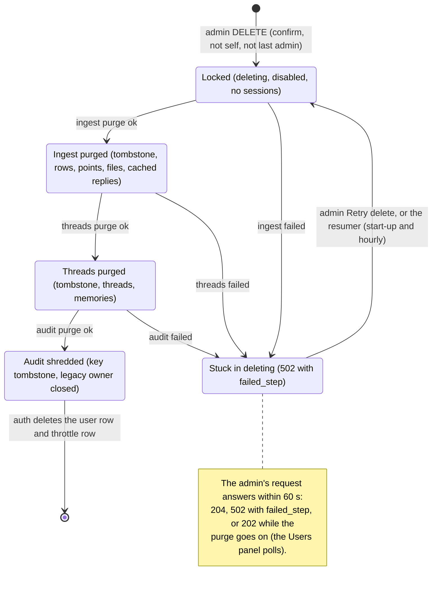

Failure modes:

1. **low: a stuck deletion.** An account left in `deleting` keeps its threads and audit key until its purge
   finishes. Handled: auth resumes every deleting account a minute after start-up and every hour, acting
   for the admin who asked, and logs each failed step (`test_a_stopped_deletion_is_resumed`,
   `test_auth_resumes_deletions_at_start_up`). Any failure inside a purge is recorded on the account, and
   one account's failure does not stop the others
   (`test_a_purge_that_raises_is_recorded_and_the_resumer_goes_on`). An account in `deleting` with no
   recorded requester is resumed as the operator, and the audit event says `requested_by: unknown`.
2. **low: the gateway timing out a deletion that is still running.** `/api/admin/` has
   `proxy_read_timeout 120s` ([default.conf.template:128](../services/gateway/default.conf.template#L128));
   auth makes three sequential calls with a 60 s client timeout each
   ([auth/services.py:55](../services/auth/src/auth/services.py#L55),
   [auth/services.py:112-117](../services/auth/src/auth/services.py#L112-L117)), and each purge can wait
   on SQLite locks (busy timeout 30 s) for its WAL truncation. Handled: the request answers within 60 s,
   with 202 while the purge goes on in auth, and the Users panel follows it until the account is gone or
   shows why it stopped (`test_a_long_deletion_answers_202_and_finishes_in_the_background`).
   `scripts/multiuser_smoke.py` follows a 202 the same way.

Approach: **implicit, with a resumer and a 202 answer.** The state already exists in `users.status`: the
resumer retries `purge_user` for every `status = 'deleting'` row at start-up and every hour, and the Users
panel polls a deletion that outlasts the admin's request.

### M3. Session and API token

- Entity: one browser session or API token. Owner: auth.
- Storage: `auth.db` table `sessions` (`kind CHECK IN ('browser','api')`, `last_seen_at`,
  `idle_expires_at`, `absolute_expires_at`, `credentials_version`)
  ([auth/store.py:51-64](../services/auth/src/auth/store.py#L51-L64)). The session's usability also depends on the account state (M1) and
  on the account's credentials version, read on every request: a session whose version differs from the
  account's is refused and deleted ([auth/api.py:101-134](../services/auth/src/auth/api.py#L101-L134)). A session is inserted only while
  the account is active, enabled and at the version its creator read before checking the password
  ([auth/store.py:518-535](../services/auth/src/auth/store.py#L518-L535)).

States:

| State | Defined by | Effect |
|---|---|---|
| Live | row exists, not expired, account Active | full access |
| Restricted | Live, account MustChange | only session, password change, logout ([auth/api.py:127-128](../services/auth/src/auth/api.py#L127-L128)) |
| Refused | row exists, account disabled or deleting, or its credentials version is old | 401 everywhere; the row is deleted on its next use, and a disable deletes the sessions in its own transaction |
| IdleExpired | browser, `idle_expires_at <= now` | 401; row deleted on next use or by the hourly purge |
| AbsoluteExpired | `absolute_expires_at <= now` | same |
| Gone | row deleted | 401 |

Transitions:

| From | To | Trigger | Where |
|---|---|---|---|
| none | Live or Restricted | sign-in (old browser session deleted first) | [auth/api.py:202-242](../services/auth/src/auth/api.py#L202-L242), [auth/api.py:141-149](../services/auth/src/auth/api.py#L141-L149) |
| none | Live | password change (new browser session), token create, `auth-admin create-token` | [auth/api.py:313](../services/auth/src/auth/api.py#L313), [auth/api.py:307-320](../services/auth/src/auth/api.py#L307-L320), [auth/cli.py:168-180](../services/auth/src/auth/cli.py#L168-L180) |
| Live | Live | request after `touch_interval_s`: idle deadline extended (browser) | [auth/api.py:131-133](../services/auth/src/auth/api.py#L131-L133), [auth/store.py:547-550](../services/auth/src/auth/store.py#L547-L550) |
| Live | IdleExpired, AbsoluteExpired | time | [auth/store.py:281](../services/auth/src/auth/store.py#L281) |
| IdleExpired, AbsoluteExpired | Gone | next use, hourly purge | [auth/api.py:117-120](../services/auth/src/auth/api.py#L117-L120), [auth/store.py:583-587](../services/auth/src/auth/store.py#L583-L587) |
| Live, Restricted | Gone | logout, token revoke, sign-in (fixation), own password change, admin reset, disable, delete step 1, `auth-admin revoke-sessions` or `reset-password`, account row deleted (cascade) | [auth/api.py:323-332](../services/auth/src/auth/api.py#L323-L332), [auth/api.py:408-415](../services/auth/src/auth/api.py#L408-L415), [auth/api.py:308-312](../services/auth/src/auth/api.py#L308-L312), [auth/api.py:295](../services/auth/src/auth/api.py#L295), [auth/api.py:417](../services/auth/src/auth/api.py#L417), [auth/api.py:400](../services/auth/src/auth/api.py#L400), [auth/services.py:111](../services/auth/src/auth/services.py#L111), [auth/cli.py:161-164](../services/auth/src/auth/cli.py#L161-L164) |
| Live, Restricted | Gone | its account's credentials version changed (password change, reset, disable, enable, delete) | [auth/api.py:101-134](../services/auth/src/auth/api.py#L101-L134) |

Guards on every use ([auth/api.py:99-129](../services/auth/src/auth/api.py#L99-L129)): a cookie must be a
browser session and a bearer token an API token; account not disabled and `active`; CSRF header for unsafe
browser requests; MustChange only where allowed; some routes need a browser session. A Refused session
never becomes Live again: enabling the account bumps the credentials version.

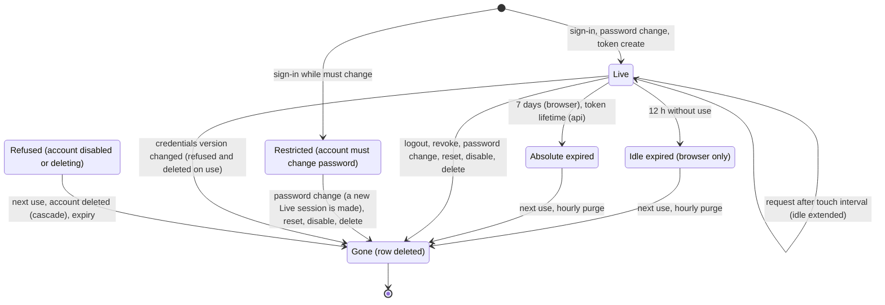

Failure modes:

1. **medium (proof A2): a sign-in that overlaps a password change must not keep a working session.**
   Changing a password deletes every session; that is the promise in the UI ("Your other sessions and API
   tokens were signed out", [account.js:70](../services/gateway/static/account.js#L70)). A sign-in with the
   old password whose Argon2 check runs at that moment creates its session afterwards. The window is one
   Argon2 verification (longer under load: hashes are limited to 4 at a time), and successful sign-ins are
   not throttled (their count is given back,
   [auth/limits.py:191-214](../services/auth/src/auth/limits.py#L191-L214)), so an attacker who has the
   password could keep signing in (10 a minute per address at the gateway) to catch the moment the user
   changes it. Handled: the session is inserted only if the credentials version is still the one read
   before the password check, and a session whose version is old is refused
   (`test_A2_a_sign_in_that_overlaps_a_password_change_gets_no_session`; token creation too:
   `test_a_token_created_while_the_password_changes_is_refused`). The same rule holds in the other
   direction: a password change whose check overlapped a reset is refused, and the rehash at sign-in writes
   only at the checked version (`test_a_password_change_whose_check_overlaps_a_reset_does_not_undo_it`).

Approach: **implicit, with a credentials version.** `users.credentials_version` is bumped in the
transaction of every password change, reset, disable, enable and delete; each session stores it at
creation; `authenticate` compares the two (a join that `session_by_hash` already does). Sign-in creates
the session with `INSERT ... SELECT ... FROM users WHERE user_id = ? AND credentials_version = ? AND status =
'active' AND disabled = 0`, using the version read before the password check, so a change during the check
makes the insert do nothing. This also covers M1 failure mode 1.

### M4. Sign-in throttle key

- Entity: one throttle key, `u:<username>` or `ip:<address>`. Owner: auth.
- Storage: `auth.db` table `login_throttle` (`failures`, `window_start`, `lock_count`, `locked_until`)
  ([auth/store.py:67-73](../services/auth/src/auth/store.py#L67-L73)).

States:

| State | Defined by |
|---|---|
| Absent | no row |
| Counting | `failures > 0`, no active lock (a window older than 15 min counts as 0 on the next failure) |
| Locked | `locked_until > now` |
| Cooling | lock over, `failures = 0`, `lock_count > 0` (the doubling history) |

Transitions:

| From | To | Trigger | Guard | Where |
|---|---|---|---|---|
| Absent, Counting, Cooling | Counting | `begin`: the attempt is counted before the password is checked | no active lock on the name or the address | [auth/limits.py:175-189](../services/auth/src/auth/limits.py#L175-L189), [auth/limits.py:139-160](../services/auth/src/auth/limits.py#L139-L160) |
| Counting, Cooling | Locked | 5th failure for a name (15 min, doubling, capped at 24 h), 20th for an address (15 min) | | [auth/limits.py:150-159](../services/auth/src/auth/limits.py#L150-L159) |
| Locked | Locked | `begin` refused with Retry-After, nothing counted | | [auth/limits.py:182-185](../services/auth/src/auth/limits.py#L182-L185) |
| Locked | Cooling | time | | |
| Cooling | Counting | history kept unless the last lock ended 24 h ago | | [auth/limits.py:154-155](../services/auth/src/auth/limits.py#L154-L155) |
| Counting, Locked (own lock) | previous or Absent | `succeed` gives the count back; a name's failures go to 0 | | [auth/limits.py:191-214](../services/auth/src/auth/limits.py#L191-L214) |
| any (name) | Absent | admin unlock, `auth-admin unlock`, account created or deleted | name key only | [auth/limits.py:224-225](../services/auth/src/auth/limits.py#L224-L225), [auth/store.py:355](../services/auth/src/auth/store.py#L355), [auth/store.py:505](../services/auth/src/auth/store.py#L505) |
| Counting, Cooling | Absent | hourly purge | no failure counted and no lock ended within `lockout_max_hours` (24 h) | [auth/store.py:637-645](../services/auth/src/auth/store.py#L637-L645), [auth/api.py:226-230](../services/auth/src/auth/api.py#L226-L230) |

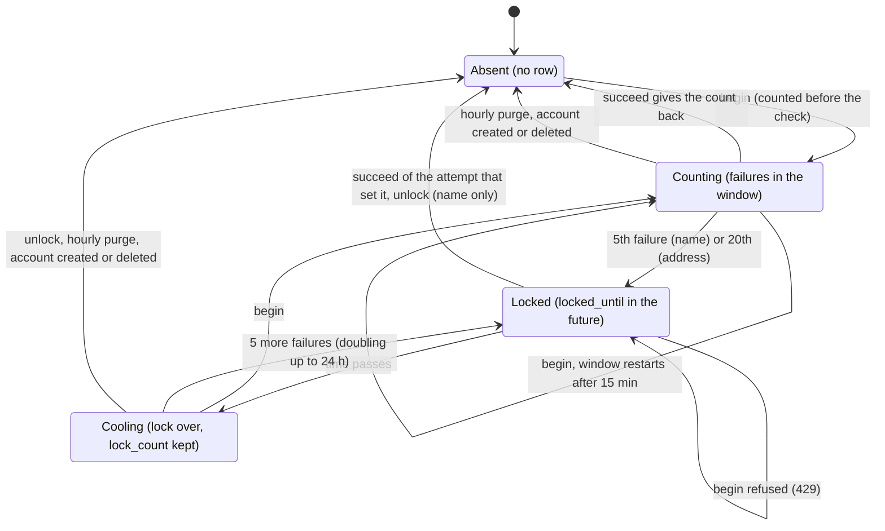

Failure modes:

1. **low (proof A1): the hourly purge erasing the doubling history after a 24 h lock.** `_counted` keeps
   `lock_count` until the last lock ended 24 h ago
   ([auth/limits.py:154-155](../services/auth/src/auth/limits.py#L154-L155)); at a lock, the window start
   is the lock time ([auth/limits.py:159](../services/auth/src/auth/limits.py#L159)). A purge of rows
   whose window started 24 h ago would drop a 24 h lock's history within an hour of its end, and the next
   lock would last 15 minutes instead of 24 hours (at the cap, about 40 guesses per 56 hours instead of 5
   per 24 hours). Handled: the purge deletes a row only when no failure was counted and no lock ended
   within `lockout_max_hours`, the same horizon the doubling uses
   ([auth/store.py:637-645](../services/auth/src/auth/store.py#L637-L645);
   `test_A1_the_hourly_purge_keeps_the_doubling_after_a_24h_lock`).
2. **low: unlock clears only the name.** An address lock stays, so after an unlock the user can still get
   429; the Users panel only shows the name's lock ([auth/api.py:137](../services/auth/src/auth/api.py#L137)).
   The Users panel's message says that a lock on a network address ends on its own. Open: address locks
   are not shown or lifted.

Approach: **implicit, with one expiry rule** shared by the purge and the doubling.

### M5. Document

Status: **explicit** (one transition function, run ids, a `deleting` state, the CHECK, and the supersede
inside the completing transaction).

- Entity: one uploaded file version of one owner. Owners: ingest-api and ingest-worker (two processes on
  one SQLite file); rag reads it.
- Storage: `registry.db` table `documents`, schema v4 ([ingest/registry.py:57-111](../services/ingest/src/ingest/registry.py#L57-L111)):
  `status` with `CHECK (status IN ('queued','processing','ready','failed','deleting'))`, built from
  `DocStatus` ([contracts.py:20-29](../libs/common/src/rag_common/contracts.py#L20-L29)); `run_id` and
  `lease_until`, the claim on the row, with `CHECK (status <> 'processing' OR run_id IS NOT NULL)`;
  `claimed_by`, who holds the claim (the worker's id, or `ingest-api`); `attempts`,
  `n_chunks`, `progress`, `error`, `tables`, `owner_id`. The model replies its runs cached, in `llm_cache.db`
  (M23), with a `uses` row per document. Files under `files/`, `assets/`,
  `tables/`, `chunks/` per owner ([ingest/paths.py:1-8](../services/ingest/src/ingest/paths.py#L1-L8)); points
  in the Qdrant collection `chunks`; references in `threads.doc_ids` and in the browser's selection.
- The allowed moves are the table `NEXT` ([ingest/registry.py:47-55](../services/ingest/src/ingest/registry.py#L47-L55)). Every status change
  goes through `_transition` ([ingest/registry.py:227-266](../services/ingest/src/ingest/registry.py#L227-L266)): it refuses a move `NEXT`
  does not allow, and a write of the worker (`run` given) unless the row is still `processing` under that
  run. It returns the row after the move, or nothing when the caller's view was stale.

States (a document is usable when `status == ready or n_chunks > 0`, see M18):

| State | status | run_id, lease_until | n_chunks | Listed, usable | What exists |
|---|---|---|---|---|---|
| Queued | queued | none | 0 | listed, no | row, source file |
| Processing | processing | the run; lease renewed every 10 s | 0 | listed, no | row, source, partial tables, figures, points |
| Ready | ready | none | > 0 | listed, yes | everything |
| Failed | failed | none | 0 | listed, no | row, source, leftovers kept for a retry |
| Queued, Processing, Failed (re-index) | as above | as above | > 0 | listed, yes (previous index) | everything from the last success, partly replaced (P5) |
| Deleting, held by its run | deleting | the run that was processing it | any | hidden | what the run writes until it sees the delete (within one renewal) |
| Deleting, held by a clean-up | deleting | a claim of ingest-api, of the worker after a supersede, or of the sweep | any | hidden | points and files being removed |
| Deleting, nobody holds it | deleting | an expired lease, or a claim of this worker's earlier process (at its start) | any | hidden | what a failed clean-up or a dead run left; the worker's sweep finishes it |
| Legacy | any, `owner_id` NULL | | | invisible, never claimed | until adopted (M7) |
| Gone | no row | | | | nothing |

While a row is deleting, an upload of the same bytes (same `doc_id`) is refused with "this file is still
being deleted" (`StillDeleting`), after the upload first tries to finish the deletion itself
([ingest/api.py:115-129](../services/ingest/src/ingest/api.py#L115-L129)). So two lifetimes of one `doc_id` never share its files. Uploads of
the same file take turns in ingest-api from the registry check to the inserted row
([ingest/api.py:99-112](../services/ingest/src/ingest/api.py#L99-L112)), and an upload that still meets a deletion removes the
file it placed. A clean-up renews its claim (a fresh lease) before each step that removes data and stops
when the claim is lost, so a clean-up slower than its lease never removes the file of a new upload.

Transitions:

| From | To | Trigger | Guard | Where |
|---|---|---|---|---|
| none | Queued | upload: file moved into place, then the row | owner not tombstoned (same statement); the same bytes from the same owner return the existing row; refused while the same file is still deleting | [ingest/api.py:132-176](../services/ingest/src/ingest/api.py#L132-L176), [ingest/registry.py:276-300](../services/ingest/src/ingest/registry.py#L276-L300) |
| Queued | Processing | worker `claim_next`: `attempts + 1`, a new `run_id`, a lease | oldest; owner set and live | [ingest/registry.py:442-459](../services/ingest/src/ingest/registry.py#L442-L459) |
| Processing | Processing | lease renewal every 10 s, `progress` text | this run | [ingest/registry.py:461-474](../services/ingest/src/ingest/registry.py#L461-L474), [ingest/worker.py:50-59](../services/ingest/src/ingest/worker.py#L50-L59) |
| Processing | Ready | `complete`; in the same transaction, older versions of the name go to Deleting | this run; owner live | [ingest/registry.py:476-507](../services/ingest/src/ingest/registry.py#L476-L507) |
| Processing | Failed | pipeline exception, `fail` | this run | [ingest/worker.py:128-135](../services/ingest/src/ingest/worker.py#L128-L135), [ingest/registry.py:509-513](../services/ingest/src/ingest/registry.py#L509-L513) |
| Processing | Queued | SIGTERM: `release`, `attempts - 1` | this run | [ingest/worker.py:70-94](../services/ingest/src/ingest/worker.py#L70-L94), [ingest/registry.py:515-520](../services/ingest/src/ingest/registry.py#L515-L520) |
| Processing | Queued or Failed | `recover`, at worker start and in every sweep | lease ran out; `attempts < max_attempts` (2) or not | [ingest/registry.py:522-544](../services/ingest/src/ingest/registry.py#L522-L544) |
| Ready | Queued | worker start: `requeue_stale`, `attempts = 0`, for a document an older index version built (`index_version` below `pipeline.INDEX_VERSION`, raised by a parsing or chunking fix) | owner set and live; queued, processing, failed and deleting rows are left alone | [ingest/registry.py:357-372](../services/ingest/src/ingest/registry.py#L357-L372), [ingest/worker.py:209-211](../services/ingest/src/ingest/worker.py#L209-L211) |
| Ready, Failed | Queued | reindex: `requeue`, `attempts = 0` | owner; a queued or processing document gets 409; so does an older version while a newer upload of its name is queued or processing (`NewerVersion`, with `INGEST_REPLACE_SAME_NAME`) | [ingest/api.py:250-262](../services/ingest/src/ingest/api.py#L250-L262), [ingest/registry.py:357-377](../services/ingest/src/ingest/registry.py#L357-L377) |
| Queued, Ready, Failed | Deleting, held by ingest-api | user delete | owner | [ingest/registry.py:374-396](../services/ingest/src/ingest/registry.py#L374-L396), [ingest/api.py:226-243](../services/ingest/src/ingest/api.py#L226-L243) |
| Processing | Deleting, held by its run | user delete; ingest-api removes the points at once, the run the files and the row | owner | same |
| Ready, Failed (older, same name, same owner) | Deleting, held by the worker | superseded, inside `complete` | inserted earlier (rowid) | [ingest/registry.py:497-507](../services/ingest/src/ingest/registry.py#L497-L507) |
| Deleting | Gone | the holder removes points, then files, then the cached model replies no other document of the owner uses (M23), then the row | the holder's claim, renewed before each step | [ingest/pipeline.py:67-87](../services/ingest/src/ingest/pipeline.py#L67-L87), [ingest/registry.py:433-438](../services/ingest/src/ingest/registry.py#L433-L438) |
| Deleting, nobody holds it | Deleting, held by the sweep or an upload | `claim_deleting` | lease ran out, or (at a worker's start) held by its earlier process | [ingest/registry.py:400-431](../services/ingest/src/ingest/registry.py#L400-L431), [ingest/worker.py:139-170](../services/ingest/src/ingest/worker.py#L139-L170) |
| any | Gone | account purge (rows and tombstone in one transaction) | | [ingest/registry.py:548-560](../services/ingest/src/ingest/registry.py#L548-L560) |
| Legacy | owned, same status | `migrate-legacy` | worker stopped or `force` | [ingest/api.py:327-347](../services/ingest/src/ingest/api.py#L327-L347), [ingest/registry.py:568-579](../services/ingest/src/ingest/registry.py#L568-L579) |

A run that finds it no longer holds its row (a renewal, a `progress` write or `complete` says so) stops at
once, the parser child included, waits for the threads it started (they cannot be stopped and may still
write a file; [ingest/pipeline.py:111-133](../services/ingest/src/ingest/pipeline.py#L111-L133)), and cleans up by what became of the row (`Pipeline.abandon`,
[ingest/pipeline.py:391-420](../services/ingest/src/ingest/pipeline.py#L391-L420)): deleting under its run, it removes points, files, cached
replies and the row; gone, it removes the points and files it wrote and the document's cached replies; its
account deleted, every point, folder and cached reply of the owner; held by anything else (another run, a new
upload of the same file), it touches nothing. The run's cache writes go through the same remembered threads,
so the clean-up comes after the last of them.

The order of work inside Processing ([ingest/pipeline.py:326-379](../services/ingest/src/ingest/pipeline.py#L326-L379)): parse in the child,
write the DuckDB tables file, describe figures, chunk, summarize (each model call looked up in the LLM cache
first and a whole reply stored after, M23), embed, write figure files, upsert points
and delete stale indexes, write the chunk file, then `complete` with the supersede in one transaction. The
superseded versions are removed afterwards, separately ([ingest/pipeline.py:381-389](../services/ingest/src/ingest/pipeline.py#L381-L389)).

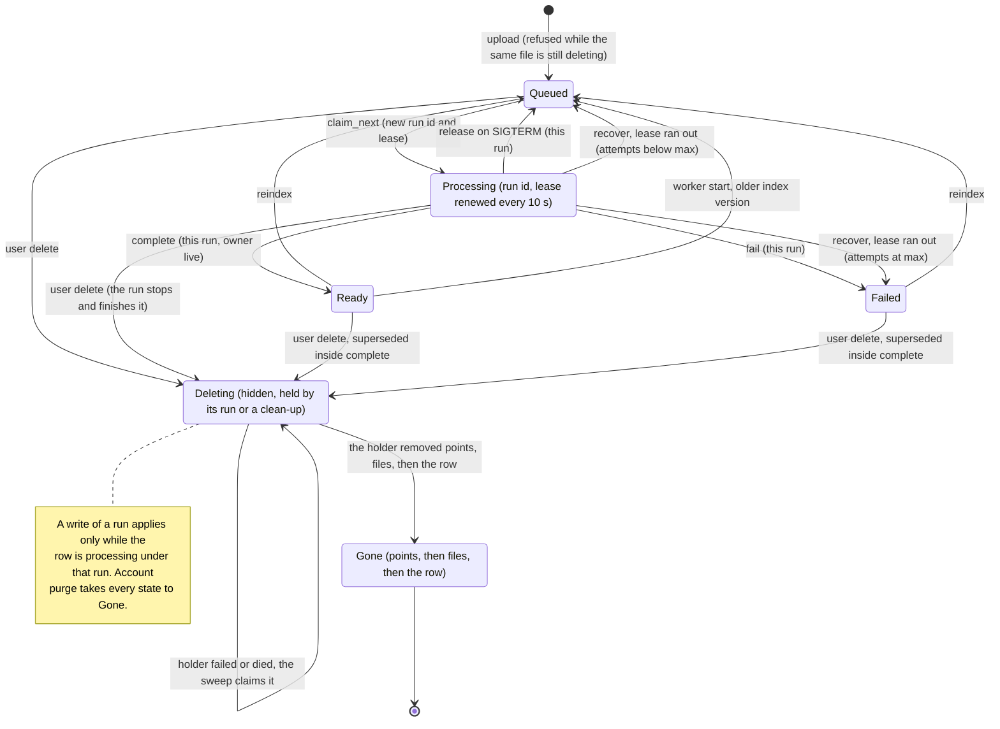

Failure modes:

1. **high (proof P2c): a stale run deleting a document the user kept.** Example: `report.pdf` v1 is ready;
   the user uploads v2 as `report.pdf`, deletes it while it is being parsed and uploads the same file as
   `report-final.pdf`. The new row gets the same `doc_id` and a newer rowid. A run that could complete the
   new row and then supersede by the name it claimed would delete v1, the version the user kept. Handled:
   `complete` applies only while the row is processing under the run's id; a delete keeps the row as
   deleting until its data is gone, and the same file cannot be uploaded again before that, so a stale run
   can neither complete the re-upload nor supersede anything. The supersede takes the name from the row
   inside `complete`'s transaction (`test_P2c_a_stale_run_never_supersedes_a_document_the_user_kept`).
2. **medium (proofs P2a, P2b): worker writes after a delete and re-upload.** Without a run token, the old
   run would mark the re-uploaded row `ready` (with the old name in every Qdrant payload) or `failed` with
   its own error, and the new row would never be processed. Handled: `progress`, `complete`, `fail` and
   `release` name the run (`test_P2a_a_stale_run_cannot_complete_a_reupload`,
   `test_P2b_a_stale_run_cannot_fail_a_reupload`). Failure mode 1 and M6 failure mode 1 have the same root.
3. **medium (proof P1): a delete during processing followed by a worker crash.** If the delete removed only
   the row and left the clean-up to the end of the run, a worker process that dies instead (OOM kill,
   `docker kill`, host restart) would leave the uploaded file and everything the job wrote (tables,
   figures, chunk file, points) until the whole account is deleted, although the user was told the
   document was deleted. Handled: the delete removes the points at once and keeps the row deleting under
   the run's lease; the run stops within one renewal and removes the files and the row; if the worker died,
   the next worker's sweep finishes it once the lease has run out
   (`test_P1_a_document_deleted_while_processing_leaves_nothing_when_the_worker_dies`).
4. **medium (proof P3): a failed supersede clean-up.** If the old row were deleted first and the point
   delete then raised (a Qdrant timeout), the error would reach the new version, which would show `failed`
   although it is fully indexed, and the old version's points and files would be orphaned. Handled: `fail`
   cannot touch a row the run no longer holds; the old versions are hidden in `complete`'s transaction and
   removed afterwards (points, files, row) in a step whose failure is logged and retried by the sweep
   (`test_P3_a_failed_supersede_clean_up_leaves_the_new_version_ready`).
5. **low (proof P5): a failed re-index stays usable on mixed data.** `write_tables` replaces the DuckDB
   file early ([ingest/pipeline.py:335-337](../services/ingest/src/ingest/pipeline.py#L335-L337)); points
   are upserted in batches ([ingest/indexer.py:64-65](../services/ingest/src/ingest/indexer.py#L64-L65));
   the chunk file and the registry's `tables` and `n_chunks` change only at the end. `fail` keeps
   `n_chunks` and `tables` ([ingest/registry.py:259-266](../services/ingest/src/ingest/registry.py#L259-L266)),
   so the document stays usable while the planner reads old schemas against the new tables file, and a
   failure inside the upsert leaves old and new points under the same ids. "Never half-missing" holds;
   "never half-mixed" does not. This matters mostly after a parser upgrade, which is when people re-index.
   Open: writing the new index beside the old one (a staging set of point ids and a tables file swapped at
   completion) is a larger change; the document shows `failed`, which tells the user to re-index again.
6. **low: an unknown `status` value.** Handled: the CHECK on `status` refuses it; the schema upgrade turns
   an unknown status into `failed` with a note.
7. **low: "superseded" is not a state.** The old id disappears; the browser's selection and the thread's
   `doc_ids` keep it (M8, M18), and nothing points to the new version except the audit event
   ([ingest/worker.py:116-118](../services/ingest/src/ingest/worker.py#L116-L118)). A superseded version
   passes through `deleting` (hidden at once, removed after). Open: there is no `superseded_by` link for the
   selection and the threads (M8, M18).

Approach: **explicit.** `DocStatus.DELETING`, the `NEXT` table, one transition function, guarded worker
writes, `deleting` finished by ingest-api, the run and the worker, the supersede inside `complete`, the
CHECK on `status`, and a table test of every (from, to) pair (`test_every_move_follows_next`). Design
choices:

- The run token is a random `run_id`, not `attempts`: `release` decrements `attempts` and a re-index resets
  it, so the same number can come back for another run.
- Each run has a lease, renewed every 10 s; `recover` takes back only rows whose lease ran out (M6 failure
  mode 1), and a starting worker also takes back at once what its own earlier process held (`claimed_by`).
- ingest-api removes the points of a processing document at once and leaves its files to the run, which
  stops within one renewal: removing the files from ingest-api would race a new upload of the same file.
- `usable` is computed by its two readers, and there is no `superseded_by` (failure mode 7, M18).

### M6. Ingest worker and parser child

- Entity: the ingest-worker process and its parser child. Owner: ingest-worker.
- Storage: process memory (`stop` event, the claimed `doc` with its `run_id`), the run's lease in the
  registry row, the file `worker.heartbeat` (mtime, read by ingest-api's readiness and `migrate-legacy`
  guard, [ingest/api.py:69-71](../services/ingest/src/ingest/api.py#L69-L71), and by the compose health check), and the child pool in
  `IsolatedRunner`.

Worker transitions ([ingest/worker.py:202-260](../services/ingest/src/ingest/worker.py#L202-L260)): start, `recover` of rows whose lease ran
out and of the rows this worker's earlier process held (its id, `INGEST_WORKER_ID`, the host name by default,
which a container keeps across restarts), heartbeat task, wait for the models service (retry every 5 s),
create the collection if needed, open the LLM cache ([ingest/worker.py:173-189](../services/ingest/src/ingest/worker.py#L173-L189): checked, a damaged file
started again, bounded; it serves jobs only when on and llama-server runs the configured weights file, M23),
then complete own-holder startup cleanup **before any new claims**. The background sweeper uses lease
expiry only, so it cannot reclaim a fresh job of this process. Start that task (`recover`, then finish
every deleting row nobody holds, then remove the cached replies of
documents that no longer exist, at once and every `sweep_interval_s`, 60 s, also while a job runs,
[ingest/worker.py:139-170](../services/ingest/src/ingest/worker.py#L139-L170)) and the loop: `claim_next`, run one job. While a job runs, its lease is
renewed every 10 s ([ingest/worker.py:70-94](../services/ingest/src/ingest/worker.py#L70-L94)); a renewal that finds the row no longer
processing under the run cancels the job, kills the parser child, waits for the job's threads and cleans
up (`Pipeline.abandon`). On
SIGTERM the job is released (back to queued) and the worker stops. Parser child
([ingest/isolation.py:26-55](../services/ingest/src/ingest/isolation.py#L26-L55)): created lazily,
recycled after 50 tasks, killed and replaced on timeout (30 min), crash or a lost run.

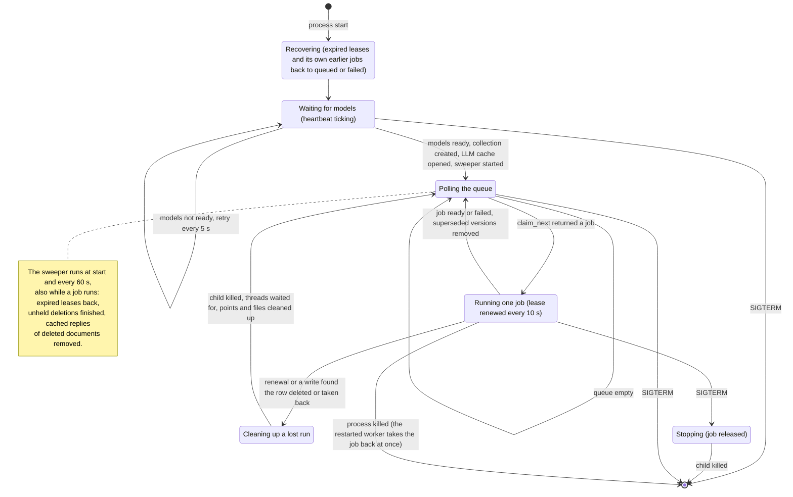

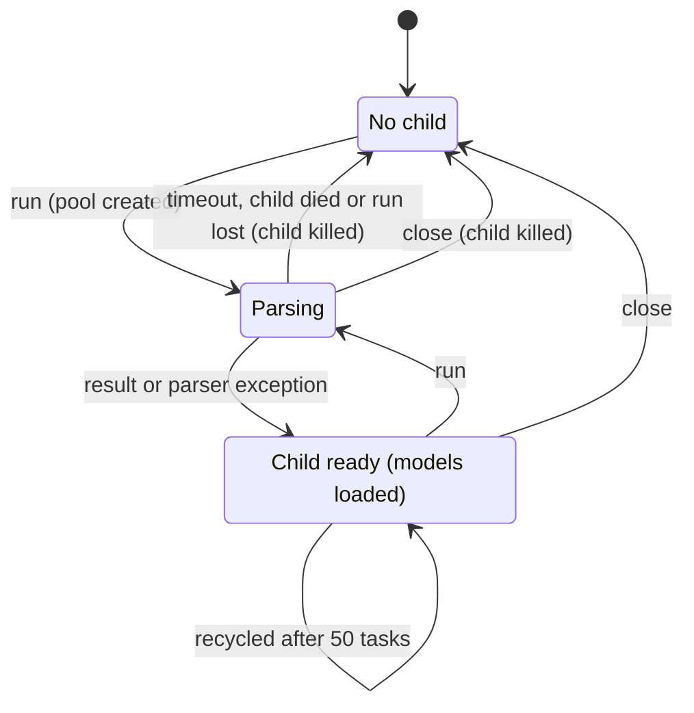

Failure modes:

1. **low (proof P4): a second worker.** The shipped `compose.yaml` runs one replica
   (`stop_grace_period: 30s`). A second worker (`docker compose up --scale ingest-worker=2`, or
   `docker compose run ingest-worker` while one runs) must not requeue and claim a document that is still
   being processed. Handled: `recover` takes back only rows whose lease ran out, and a run's writes name its
   run id (`test_P4_a_second_worker_start_leaves_a_running_job_alone`). A restarted worker takes back its
   own crashed job at once (`claimed_by`), and other workers' expired jobs within one sweep
   (`test_a_restarted_worker_takes_back_its_own_job_at_once`).

Approach: **implicit, with a lease per run.** One worker is the shipped setup (parse throughput is bound by
the one GPU).

### M7. Legacy data adoption

- Entity: the data written before accounts existed, in each data service. Owners: auth (`auth-admin
  migrate-legacy`, [auth/cli.py:106-127](../services/auth/src/auth/cli.py#L106-L127)) driving ingest,
  threads and audit in the order audit, threads, ingest
  ([auth/services.py:18](../services/auth/src/auth/services.py#L18),
  [auth/services.py:97-103](../services/auth/src/auth/services.py#L97-L103)).
- Storage: `documents.owner_id IS NULL`, `threads.user_id IS NULL`, `memories.user_id IS NULL`, audit
  `meta.legacy_owner` (absent, a user id, or `deleted`).

| From | To | Trigger | Where |
|---|---|---|---|
| Unowned | Adopted | ingest: rows, then files moved, then points (refused while the worker runs unless `force`) | [ingest/api.py:327-347](../services/ingest/src/ingest/api.py#L327-L347) |
| Unowned | Adopted | threads: threads and memories in one transaction (a duplicate memory stays unowned) | [threads/store.py:358-374](../services/threads/src/threads/store.py#L358-L374) |
| Unowned | Adopted | audit: `meta.legacy_owner` set once; another user gets 409 | [audit/store.py:332-356](../services/audit/src/audit/store.py#L332-L356) |
| Adopted | Closed or gone | the adopting account is purged (audit tombstone; ingest and threads rows deleted with the owner) | [audit/store.py:323-324](../services/audit/src/audit/store.py#L323-L324) |

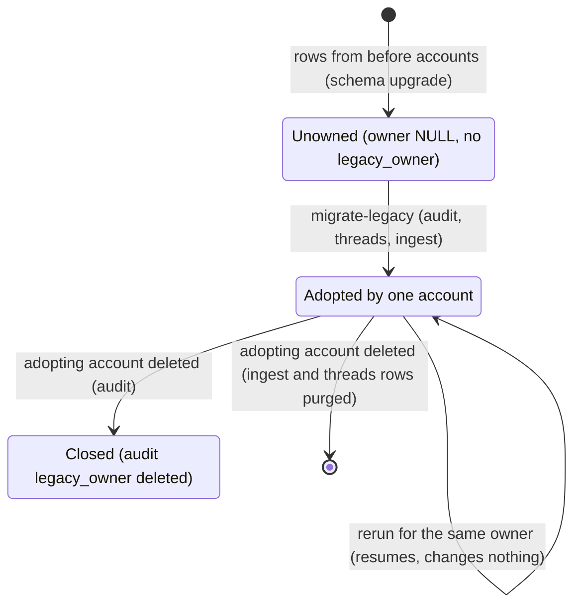

Failure modes:

1. **low:** a run that stops after audit (the first step) has fixed the audit owner; a rerun for another
   user is refused by audit while ingest and threads still hold unowned rows. Nothing records which
   services adopted. Open.
2. **low:** ingest checks the tombstone and adopts in two connections
   ([ingest/registry.py:571-578](../services/ingest/src/ingest/registry.py#L571-L578)), unlike threads,
   which does both in one transaction. Operator-only and a very narrow window. Open.

Approach: **implicit.** It is a one-time migration. Open: do the ingest check inside the UPDATE, as `add`
does.

### M8. Thread and compaction

- Entity: one conversation. Owners: threads (storage), rag (appends and compaction), the UI (creation).
- Storage: `threads.db` `threads` (`summary`, `summary_upto`, `doc_ids`), `messages`
  ([threads/store.py:35-54](../services/threads/src/threads/store.py#L35-L54)).

| From | To | Trigger | Guard | Where |
|---|---|---|---|---|
| none | Empty | `POST /api/threads` from the UI before the first chat request | owner not tombstoned | [app.js:546-553](../services/gateway/static/app.js#L546-L553), [threads/store.py:179-189](../services/threads/src/threads/store.py#L179-L189) |
| Empty, Active, Summarized | Active or Summarized | rag appends the user and assistant messages, `doc_ids` replaced | issued by rag; owner not tombstoned | [rag/api.py:183-185](../services/rag/src/rag/api.py#L183-L185), [threads/store.py:229-250](../services/threads/src/threads/store.py#L229-L250) |
| Active, Summarized | Summarized | background `maintain` folds older turns | `summary_upto` only grows | [rag/conversation.py:151-170](../services/rag/src/rag/conversation.py#L151-L170), [threads/store.py:262-267](../services/threads/src/threads/store.py#L262-L267) |
| any | Deleted | user delete, account purge | owner | [threads/store.py:217-220](../services/threads/src/threads/store.py#L217-L220), [threads/store.py:340-356](../services/threads/src/threads/store.py#L340-L356) |

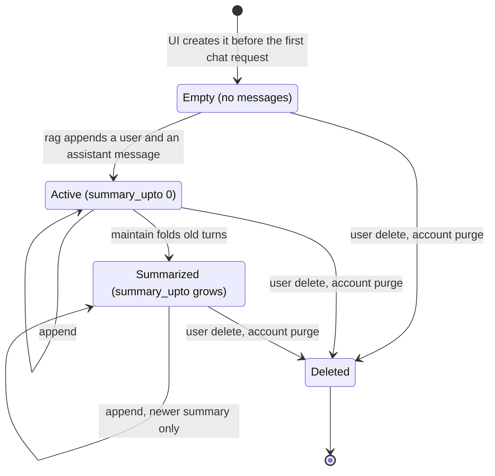

Failure modes (both open):

1. **low:** a thread stays Empty when the first chat request fails before streaming (409 "documents not
   ready yet", 404 unknown documents, [rag/api.py:136-143](../services/rag/src/rag/api.py#L136-L143)); the
   UI created it first and only forgets it on a thread 404 ([app.js:565-570](../services/gateway/static/app.js#L565-L570)).
2. **low:** `doc_ids` keeps ids that were later deleted or superseded. On open, the UI keeps only usable
   ids, and when none is left it keeps whatever is currently selected
   ([app.js:652-654](../services/gateway/static/app.js#L652-L654)); the next answer then overwrites the
   thread's `doc_ids` with that unrelated selection ([threads/store.py:245-247](../services/threads/src/threads/store.py#L245-L247)).

The summary pointer itself is a good explicit rule: `set_summary` refuses to move backwards, so a late,
stale compaction cannot overwrite a newer one.

Approach: **implicit.** Open: let `/v1/chat` create the thread on its first successful turn (or delete an
Empty thread when the first request fails), and clear the selection when a thread's documents are all
gone.

### M9. Long-term memory item

- Entity: one remembered fact. Owners: threads (storage), rag (router and background extraction), the UI
  (Memory panel, undo chips).
- Storage: `threads.db` `memories` (`source` 'user' or 'auto' with no CHECK, `thread_id` with no foreign
  key, `UNIQUE (user_id, norm)`) ([threads/store.py:55-65](../services/threads/src/threads/store.py#L55-L65)).

| From | To | Trigger | Where |
|---|---|---|---|
| none | Auto or User | router save (User for an explicit remember request), background extraction (Auto), Memory panel and undo of a forget (User) | [rag/intent.py:242-299](../services/rag/src/rag/intent.py#L242-L299), [rag/conversation.py:166-168](../services/rag/src/rag/conversation.py#L166-L168), [app.js:455-456](../services/gateway/static/app.js#L455-L456), [threads/store.py:281-307](../services/threads/src/threads/store.py#L281-L307) |
| Auto, User | same id, new text; User stays User | contradiction replaced in place | [threads/store.py:309-331](../services/threads/src/threads/store.py#L309-L331) |
| Auto | Gone | evicted: the oldest Auto at the cap (50) | [threads/store.py:294-300](../services/threads/src/threads/store.py#L294-L300) |
| Auto, User | Gone | forget in chat, delete in the panel, undo of a save, account purge | [threads/store.py:333-336](../services/threads/src/threads/store.py#L333-L336) |

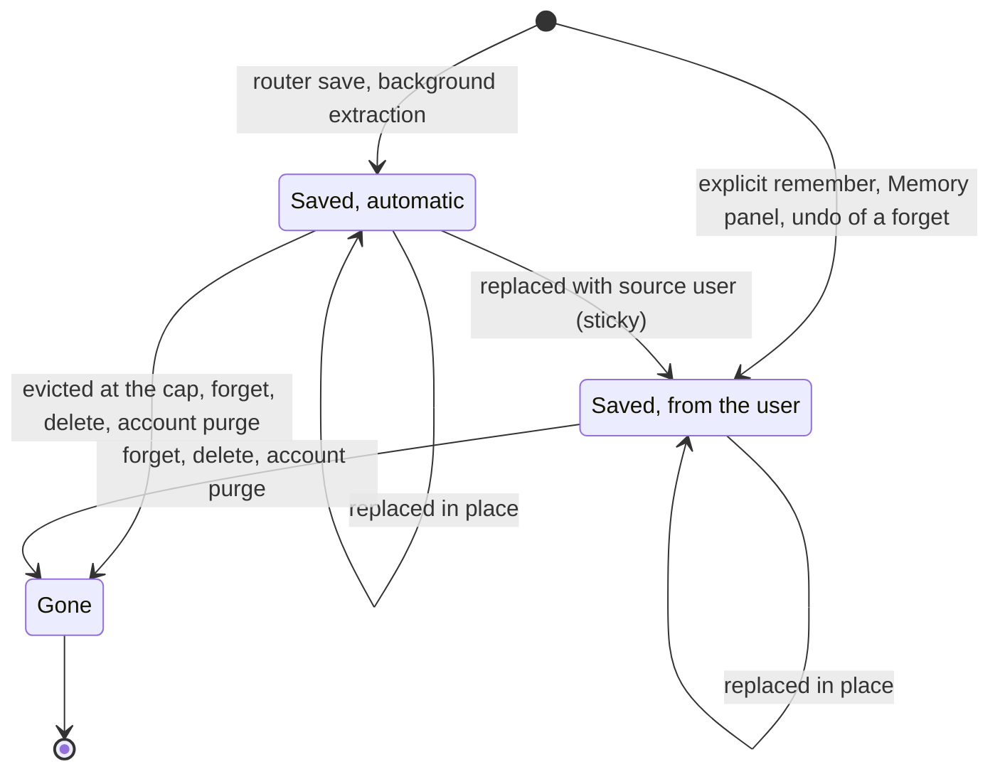

Failure modes (both open):

1. **low:** deleting a thread leaves `memories.thread_id` pointing at it (no foreign key; the delete at
   [threads/store.py:217-220](../services/threads/src/threads/store.py#L217-L220) does not touch memories).
2. **low:** undoing a forget re-adds the item with `source: "user"`
   ([app.js:455-456](../services/gateway/static/app.js#L455-L456)), so an automatic memory becomes
   permanent (never evicted).

Approach: **implicit.** Open: add `CHECK (source IN ('user','auto'))`, set `thread_id = NULL` when a
thread is deleted, and send the original source on undo (effort S).

### M10. Audit key and legacy owner

- Entity: one user's audit encryption key; the owner of the pre-account audit rows. Owner: audit.
- Storage: `audit.db` `user_keys.dek` (32 bytes, or `X''` as the tombstone), `meta.legacy_owner`
  ([audit/store.py:64-73](../services/audit/src/audit/store.py#L64-L73)).

| From | To | Trigger | Where |
|---|---|---|---|
| NoKey | KeyActive | first event of the user | [audit/store.py:209-215](../services/audit/src/audit/store.py#L209-L215) |
| KeyActive | KeyActive | event, detail encrypted | [audit/store.py:216-217](../services/audit/src/audit/store.py#L216-L217) |
| NoKey, KeyActive | Shredded | account purge (secure delete, WAL truncated) | [audit/store.py:308-330](../services/audit/src/audit/store.py#L308-L330) |
| Shredded | Shredded | a late event: stored as `{"_shredded": true}` | [audit/store.py:216-217](../services/audit/src/audit/store.py#L216-L217) |

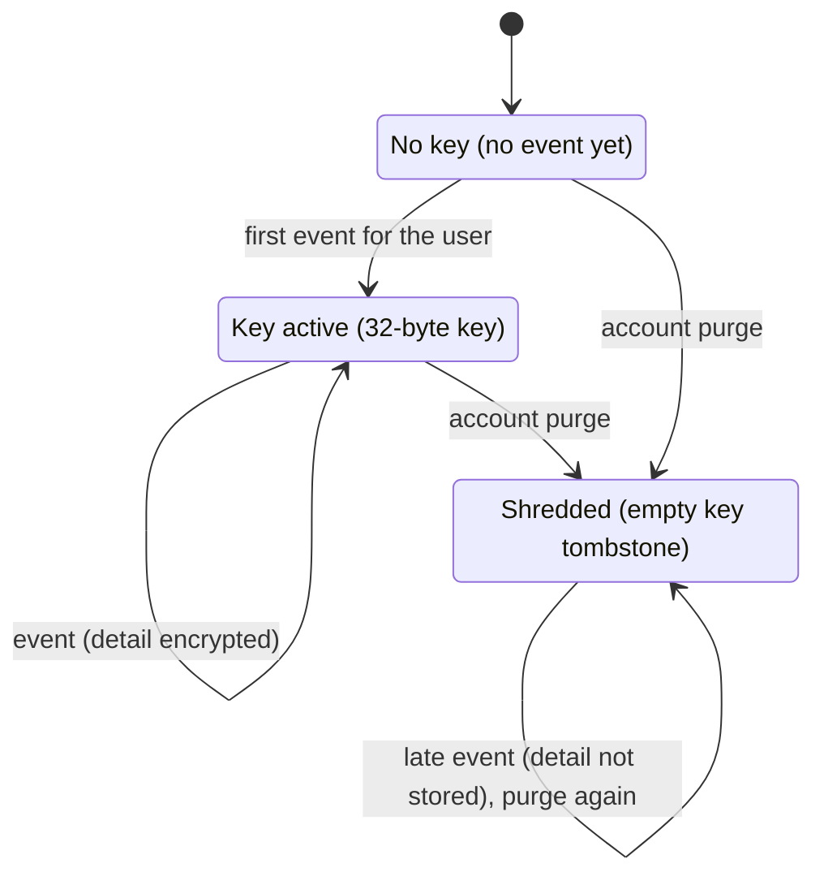

Failure modes: none in the machine; every transition is one transaction under a process lock. Across
machines: audit writes are best effort ([rag_common/audit.py:44-62](../libs/common/src/rag_common/audit.py#L44-L62)),
so the trail can miss transitions of M1, M5 and others while audit is down (by design, and logged at
ERROR).

Approach: **implicit.** Optional: `CHECK (length(dek) IN (0, 32))`.

### M11. Chat turn routing

- Entity: one chat turn. Owner: rag. Storage: request memory: `Intent.kind`
  ([rag/intent.py:38-39](../services/rag/src/rag/intent.py#L38-L39)), `Plan.route`
  ([rag/planner.py:17](../services/rag/src/rag/planner.py#L17)); the result is persisted as
  `meta.route` on the assistant message.

Transitions ([rag/turn.py:48-99](../services/rag/src/rag/turn.py#L48-L99)): a thread chat is routed by
one JSON LLM call (unknown or unusable answers become `documents`,
[rag/intent.py:171](../services/rag/src/rag/intent.py#L171), [rag/intent.py:219-221](../services/rag/src/rag/intent.py#L219-L221));
a recall with documents selected and no reference to the user becomes `documents` (170-171); a memory
request that also asks a question becomes `documents` (197-198). The memory part is applied first
(54-58), then: memory kinds answer directly (63-66), `assistant` (67-76), `history` (77-86, or
falls through on `NEED_SEARCH`), no documents selected (90-94), otherwise single-shot (with the planner
when a document has tables, [rag/chat.py:106](../services/rag/src/rag/chat.py#L106)), deep research
(97-99) or an exhaustive answer (M24) for a request's mode `exhaustive`.
Stateless calls skip routing and memory (59-60).

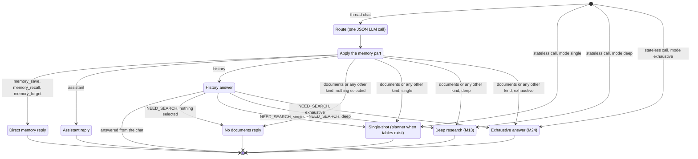

Failure modes:

1. **low: an intent kind that is accepted but not handled.** A kind added to `Kind` and accepted by
   `parse_intent` but not handled in `respond` must not fall through to a document search, and the UI's
   labels and "no search" set ([app.js:5-11](../services/gateway/static/app.js#L5-L11)) must not drift
   from the routes. Handled: `respond` dispatches with `match intent.kind` and `assert_never`
   ([rag/turn.py:70-98](../services/rag/src/rag/turn.py#L70-L98)), so such a kind raises instead of
   searching; `ROUTES` lists every route a turn reports, and a test checks that the UI labels each one and
   that `NO_SEARCH_ROUTES` is exactly the routes answered without a search
   (`services/rag/tests/test_events.py`).

Approach: **implicit,** with `match intent.kind` and `assert_never` over the `Literal`, and the label test.

### M12. Chat event stream

- Entity: one `/v1/chat` response. Owners: rag (producer, [rag/api.py:227-260](../services/rag/src/rag/api.py#L227-L260))
  and five consumers: [app.js:571-599](../services/gateway/static/app.js#L571-L599),
  [scripts/smoke_test.py:62-82](../scripts/smoke_test.py#L62-L82),
  [scripts/memory_smoke.py:42-64](../scripts/memory_smoke.py#L42-L64),
  [scripts/multiuser_smoke.py:311-332](../scripts/multiuser_smoke.py#L311-L332) (parser at 111-122),
  [eval/src/rag_eval/client.py:50-72](../eval/src/rag_eval/client.py#L50-L72).
- Storage: the order of events on the wire; afterwards `meta.interrupted`, `meta.error`, `meta.notices` and
  `meta.finish_reason` on the saved message (rag/api.py, `_persist`).

Status: **explicit**. The protocol is written down once in `rag_common/chat_events.py`
([chat_events.py:22-60](../libs/common/src/rag_common/chat_events.py#L22-L60)): the `ChatEvent` enum, the phases, and `NEXT`, the events each phase
allows and the phase they lead to; `Order` follows a stream through it. rag yields only `ChatEvent`
members, and `_sse` turns an unknown name into an `error` event ([rag/api.py:228-261](../services/rag/src/rag/api.py#L228-L261)). One
reader, `read_chat` ([chat_events.py:150-177](../libs/common/src/rag_common/chat_events.py#L150-L177)), collects an answer, checks the order and
reports which terminal event arrived; eval and the three live scripts use it, and count a cut stream, an
`error` event or events out of order as a failed answer. The web UI keeps its own reader and its
"interrupted" message ([app.js:571-599](../services/gateway/static/app.js#L571-L599)). The paragraph below is the order `NEXT`
encodes.

Order the producer emits: `memory` events (thread chats) ([rag/turn.py:64-65](../services/rag/src/rag/turn.py#L64-L65));
optionally one `token` with the memory notes **before** `sources` ([rag/turn.py:95-96](../services/rag/src/rag/turn.py#L95-L96));
`step` events in deep mode ([rag/agent.py:246-260](../services/rag/src/rag/agent.py#L246-L260))
and in exhaustive mode (`sections`, `map`, `reduce`; M24); exactly one
`sources`; `reasoning` and `token` events; one `done`
([rag/chat.py:91-92](../services/rag/src/rag/chat.py#L91-L92)). An exception after the stream began
becomes one `error` event and no `done` ([rag/api.py:253-256](../services/rag/src/rag/api.py#L253-L256)).
A client disconnect gets no event; the exchange is saved with `interrupted: true` (250-252, 257-260).

**Notices.** A `notice` event (`{code, message}`) may come at any point
before the end and leaves the phase as it was: `NEXT[phase][NOTICE] = phase` for every phase that is not
terminal. rag never falls back silently: the planner falling back to search, an answer cut at its token
limit, a figure that could not be loaded, a failed query rewrite or intent routing, and every deep-research
budget or failure queue a notice (`rag/notices.py`, a per-request list in a context variable that
LangGraph's tasks share). `_sse` sends the queued notices just before the next event, so a notice raised
while the answer streamed arrives before `done`, and one raised before an exception arrives before
`error`. The UI lists them under the answer, `read_chat` collects them (`ChatReply.notices`), and the
thread and the audit record keep them.

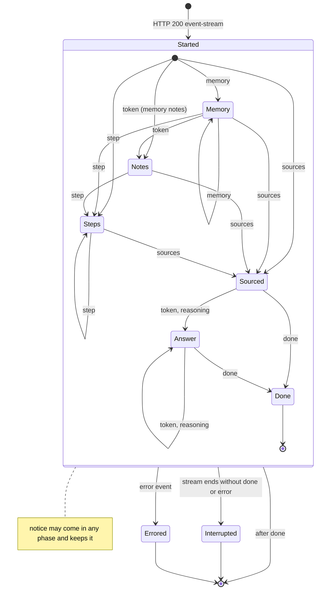

Failure modes:

1. **low: a cut stream taken for a complete answer.** Handled: `read_chat` reports `terminal` (`done`,
   `error` or none) and a `failure`; `smoke_test`, `memory_smoke` (which also fails a run whose answers
   ended in `error`), `multiuser_smoke` and eval use it. The web UI tracks the terminal event itself
   ([app.js:539](../services/gateway/static/app.js#L539),
   [app.js:596-599](../services/gateway/static/app.js#L596-L599)).
2. **low: event names and order written out in several places.** An added event would be dropped silently
   by every client, and an undocumented order (such as "token before sources") would drift. Handled: the
   names and the order are `ChatEvent` and `NEXT`; a test runs every branch of `respond` and deep research
   (with a replayed graph) and checks each stream against `NEXT`, also after the wire and back. Open (low):
   the UI drops an unknown event silently ([app.js:571-595](../services/gateway/static/app.js#L571-L595));
   the producer cannot send one.

Approach: **explicit.** A `ChatEvent` enum and an order table in `libs/common`
(`NEXT = {START: {MEMORY, TOKEN, STEP, SOURCES}, ...}`), a validator used by a rag test that runs each
branch of `respond` with fakes, and one shared Python reader, `read_chat`, for the scripts and eval.

### M13. Deep research graph

- Entity: one deep-mode research run. Owner: rag. Storage: the LangGraph `ResearchState`
  ([rag/agent.py](../services/rag/src/rag/agent.py), `ResearchState`), or, with `RAG_DEEP_AGENT=deepagents`
  (or a request's `agent`), the `create_agent` state of the deepagents harness and a per-run `Run`
  ([rag/agent_deepagents.py](../services/rag/src/rag/agent_deepagents.py)). Both live for one request only.

The LangGraph implementation (`RAG_DEEP_AGENT=langgraph`, the default) is an explicit state machine
(rag/agent.py, `build_graph`): named nodes, declared edges, bounded loops. Tool calls are capped at
`agent_max_steps` (10), the research prompt at the slot (the prompt plus a retried step's room must fit
32,768 tokens, counted as the model counts them), verify rounds at `agent_verify_rounds` (2), and the
recursion limit is `agent_recursion_limit` (80); the longest path is 1 + 2 x 10 + 2 x 3 = 27 steps, well
inside the limit. Verify also ends the run without another model call when the round before found no new
source (its list of missing facts still holds, and becomes a notice), and the agent node goes to verify
when a step fails after its retry or the research prompt is full. Verify first checks a mixed selection
(text documents and tables): when no passage of a text
document was found it searches them once itself and, while rounds remain, sends the agent back with the
results (the existing verify-to-agent edge, counted as a round). Once the slot or the tool calls are used
up, verify still runs its check but never takes that edge back to the agent (a `stopped` flag the agent
node sets), so a full prompt is one notice and one verify call, not a loop of empty agent visits. Each of
these exits, and a used-up budget, is a notice to the user (M12).

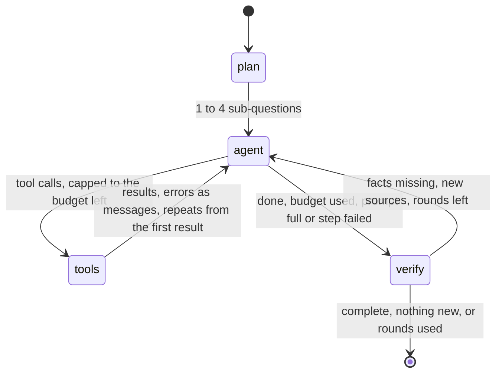

**The deepagents implementation** (`RAG_DEEP_AGENT=deepagents`; ARCHITECTURE section 7.6). Also explicit:
langchain's `create_agent` graph (a model node, a tool node, the middleware's hook nodes and declared jumps) with the harness's middleware and three of ours. Its state adds `todos`
(`write_todos`), `files` (the virtual files: kept large results and summarized history, a reducer-merged
channel of this run's state, never on disk) and `_summarization_event`; the counters and flags shared with
sub-agents are a `Run` object made per request: research calls (capped at `agent_max_steps`, 10),
harness calls (`write_todos`, `read_file`, `task`; capped at `deep_harness_calls`, 12), verify rounds
(`agent_verify_rounds`, 2), the source count at the last check, and `stopped`. Exits: a used-up budget is
refused at the tool and ends the run at the next model step (`jump_to: end`, a notice); a prompt that
would outgrow the slot returns `DONE` without a model call and sets `stopped`, so verify sends no one back;
a failed step is retried once and then returns `DONE` (a notice). Verify runs after a reply without tool
calls and returns to the model (`jump_to: model`) only while rounds remain and, after the first round, only
when something new was found. Every model call either calls tools (each counted against a budget), or ends the lead or a
sub-agent, or is sent back by verify (at most 2 times), so the budgets bound the run: the lead makes at most
10 + 12 + 2 + 1 model calls, and each `task` (itself a harness call) one more final reply. The lead graph's
recursion limit is computed from those budgets (6 steps a call, 166 by default).

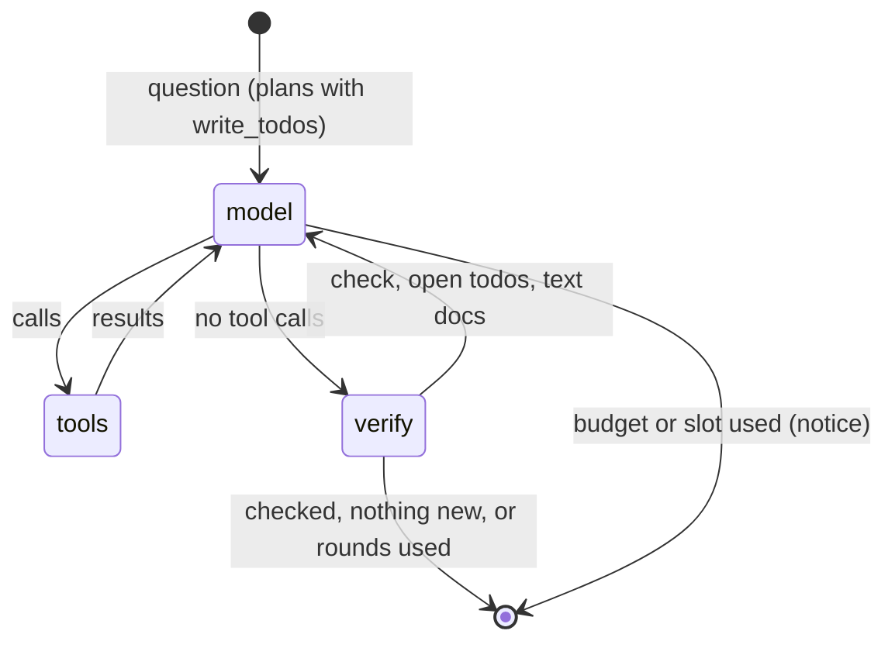

The out-of-the-box arm (`RAG_DEEP_AGENT=deepagents_stock`,
[rag/agent_deepagents_stock.py](../services/rag/src/rag/agent_deepagents_stock.py)) is `create_deep_agent`'s
graph with its default middleware and the same `Run`, budgets and slot guard (our middleware in the lead and
in its general-purpose sub-agent). It is the diagram above without the `verify` state: a reply without tool
calls ends the run. Its summarization (from 170,000 tokens) and eviction (from 20,000 tokens counted as 4
characters a token) never fire in the slot, so the slot guard is its only exit for a growing prompt.

**Fan-out leases** (`RAG_DEEP_FANOUT` or a request's `fanout`, for an arm that supports it;
[rag/fanout.py](../services/rag/src/rag/fanout.py)). With fan-out, each `task` call of the lead has a lease: a
`Lease` object (calls reserved, used, the source numbers found, `stopped`) in the run's `FanOut`, made before any
await and handed to the researcher's graph through a context variable. Its states:

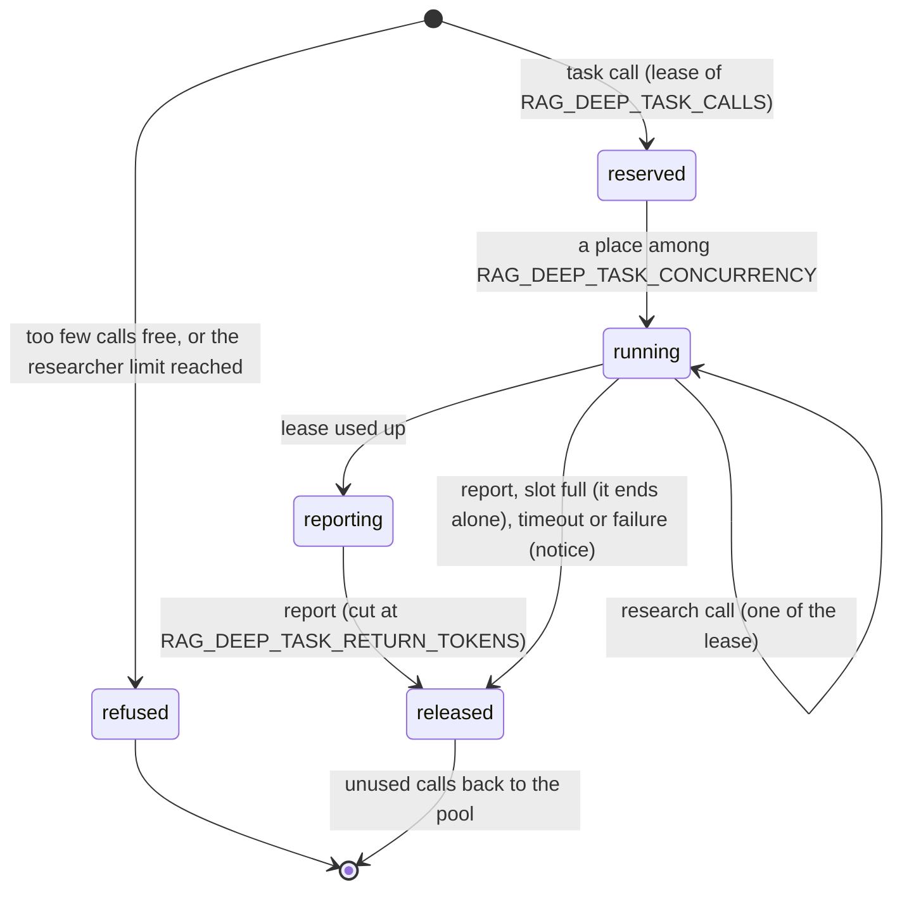

The lead's research calls run only while used plus reserved stays under the budget, so the budget bounds the
run as it does without fan-out; a researcher makes at most its lease of research calls and one more model call after it. The
counting happens before any await, so calls of one reply cannot overrun it.

Failure modes: none known. Approach: **explicit.** The three implementations (`langgraph`, `deepagents`,
`deepagents_stock`) are selectable with `RAG_DEEP_AGENT` or a request's `agent`; `langgraph` is the
default.

### M14. GPU gate

- Entity: the models service's GPU queue. Owner: models. Storage: process memory, `_waiting` and an
  `asyncio.Lock` ([models_svc/gate.py:14-28](../services/models/src/models_svc/gate.py#L14-L28)).

`_waiting` counts the running job and the waiting ones; a call is refused with 503 when
`_waiting >= max_waiting` (32 by default).

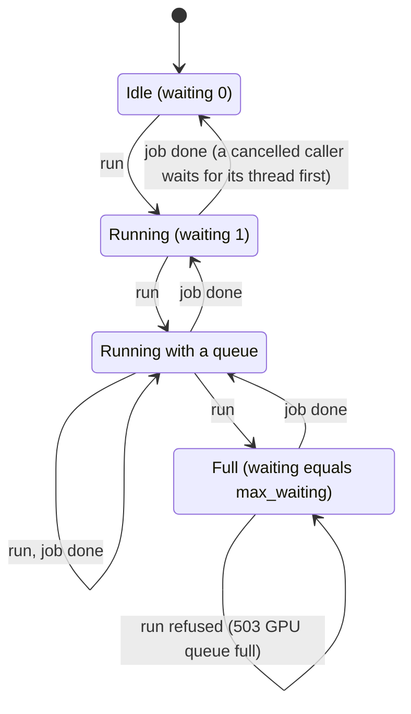

Failure modes:

1. **low (proof G1): a cancelled caller and a job still on the GPU.** If the awaiting task is cancelled,
   leaving `async with self._lock` would release the lock while the thread started by `asyncio.to_thread`
   keeps running, and the next job would start on the GPU beside it. The trigger is task cancellation (for
   example at shutdown); a client that simply times out does not cancel the handler. Handled: a cancelled
   caller waits for its job's thread (shielded, also when cancelled again) before it leaves the gate
   ([models_svc/gate.py:27-44](../services/models/src/models_svc/gate.py#L27-L44);
   `test_G1_a_cancelled_caller_holds_the_gate_until_its_gpu_job_ends`).
2. **low (proof G2):** `max_waiting` includes the running job: with `MODELS_MAX_WAITING=1` nothing ever
   waits. Kept and documented: the docstring and the setting's comment say that the running job counts
   toward `MODELS_MAX_WAITING`; changing the bound would change the capacity of every install.

Approach: **implicit;** a cancelled caller waits for its thread (shielded), and the bound is documented.

### M15. Identity assertion

- Entity: one signed `X-Identity` assertion, and each process's enforcement mode. Owner: libs/common,
  used by every service. Storage: the header; `current_identity` context variable; the module flag
  `_enforced` ([rag_common/identity.py:277-283](../libs/common/src/rag_common/identity.py#L277-L283)).

An assertion is signed by auth after `/internal/verify` or for system calls, and re-signed by rag for
every downstream call made while an identity is in context
([rag_common/identity.py:264-274](../libs/common/src/rag_common/identity.py#L264-L274)). It lives 120 s
(36) and is checked in a fixed order: shape, payload keys, issuer, signature, lifetime, role, subject
(199-250).

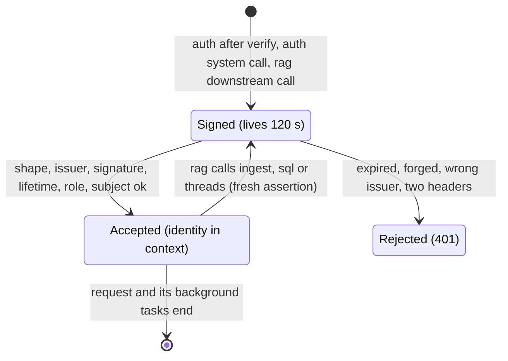

Failure modes:

1. **low:** a chat authorized before an account is disabled keeps working until it ends, background
   compaction and memory extraction included ([rag/api.py:189-192](../services/rag/src/rag/api.py#L189-L192)),
   because rag mints fresh assertions from the context. Deletion is covered by the tombstones in ingest and
   threads; disabling is not. Open.

Approach: **implicit.** The gap for disable is accepted; threads and ingest could refuse a "disabled"
marker the same way they refuse tombstones if that matters.

### M16. Gateway request flow

- Entity: one HTTP request through nginx. Owner: gateway. Storage: nginx variables
  ([default.conf.template](../services/gateway/default.conf.template)).

| From | To | Trigger | Where |
|---|---|---|---|
| received | dropped (444) | Host not listed | [default.conf.template:44-49](../services/gateway/default.conf.template#L44-L49) |
| received | 403 | Origin rule fails | [default.conf.template:27-33](../services/gateway/default.conf.template#L27-L33), [default.conf.template:77](../services/gateway/default.conf.template#L77) |
| received | proxied to auth | `/api/auth/*`, `/api/admin/*` (sign-in limited to 10 a minute, burst 5) | [default.conf.template:101-132](../services/gateway/default.conf.template#L101-L132) |
| received | auth_request | any other `/api/*` | [default.conf.template:136-141](../services/gateway/default.conf.template#L136-L141), [default.conf.template:83-98](../services/gateway/default.conf.template#L83-L98) |
| auth_request | proxied with `X-Identity` | 204 | [default.conf.template:147](../services/gateway/default.conf.template#L147) |
| auth_request | 401 JSON | 401 | [default.conf.template:197-200](../services/gateway/default.conf.template#L197-L200) |
| auth_request | 403 JSON with the reason | 403 and `X-Auth-Detail` | [default.conf.template:34-38](../services/gateway/default.conf.template#L34-L38), [default.conf.template:201-204](../services/gateway/default.conf.template#L201-L204) |
| auth_request | 500 | any other status or a timeout (10 s) | [default.conf.template:95](../services/gateway/default.conf.template#L95) |

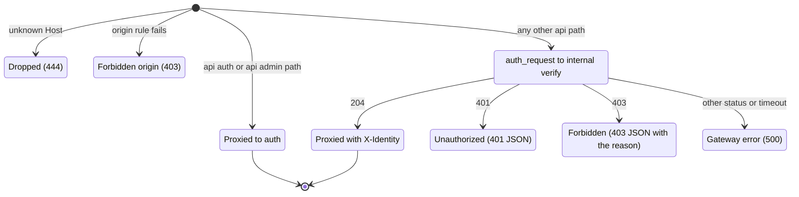

Failure modes:

1. **low:** the MustChange state crosses the gateway as free text: auth raises "password change required"
   ([auth/api.py:128](../services/auth/src/auth/api.py#L128)), nginx copies it into the body, and the UI
   compares the exact string ([app.js:79](../services/gateway/static/app.js#L79)). Rewording it silently
   stops the redirect to the password form. Open.
2. **low:** the 120 s admin timeout against a long account purge. Handled: see M2 failure mode 2.

Approach: **implicit.** Open: send a code (`X-Auth-Code: password_change_required`) next to the text
(effort S).

### M17. UI chat composer

- Entity: the chat area of one browser tab. Owner: gateway UI. Storage: `state.busy`, `state.threadId`
  and the `#t=` hash ([app.js:14-23](../services/gateway/static/app.js#L14-L23),
  [app.js:620-623](../services/gateway/static/app.js#L620-L623)), and the local `finished` flag in `ask`.

| From | To | Trigger | Guard | Where |
|---|---|---|---|---|
| New | Creating | send | not busy | [app.js:793-799](../services/gateway/static/app.js#L793-L799), [app.js:546-553](../services/gateway/static/app.js#L546-L553) |
| Creating, InThread | Streaming | chat request accepted | | [app.js:554-571](../services/gateway/static/app.js#L554-L571) |
| Streaming | InThread | `done`, `error`, or the stream ends | | [app.js:587-607](../services/gateway/static/app.js#L587-L607) |
| Streaming | New | thread 404 on the chat request | | [app.js:568](../services/gateway/static/app.js#L568) |
| InThread | InThread | open another chat | refused while busy | [app.js:620-637](../services/gateway/static/app.js#L620-L637) |
| InThread | Streaming | *Retry* on an answer that failed or was interrupted (asks the same question again, after restoring that turn's documents, mode and Think from the request or the saved meta) | not busy | app.js, `retryButton`, `restoreTurn` |
| InThread | New | New chat, delete the open chat, bad link | not busy (New chat and delete are refused while an answer streams) | [app.js:729-740](../services/gateway/static/app.js#L729-L740), [app.js:869](../services/gateway/static/app.js#L869) |

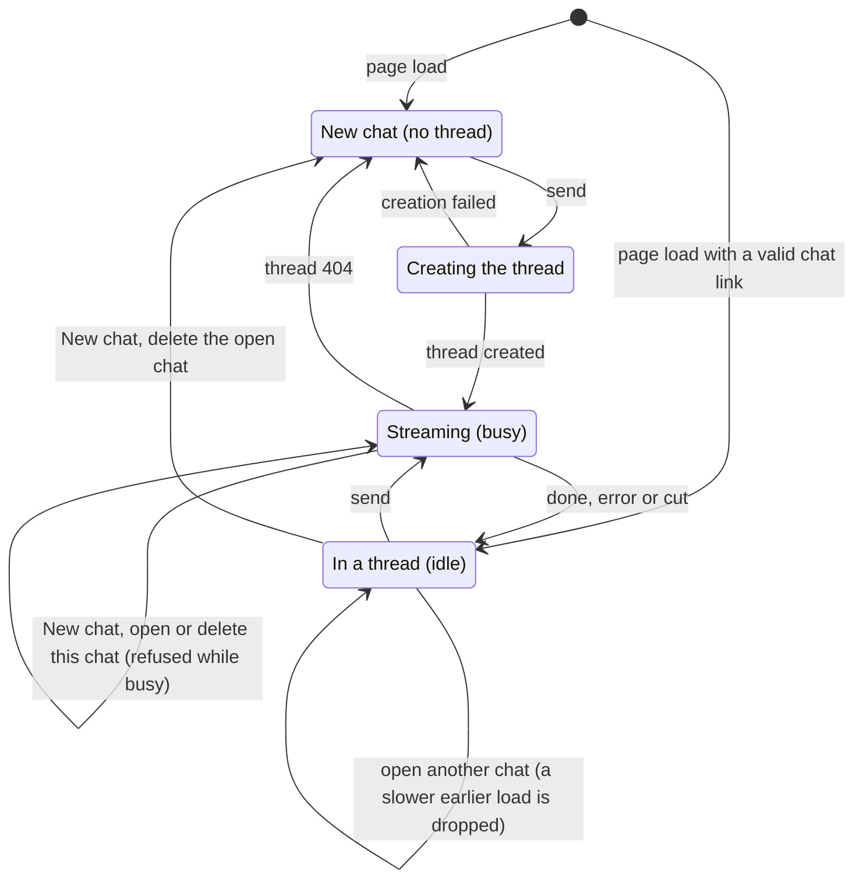

Failure modes:

1. **low: a new chat during an answer.** It would detach the answer from the screen (the answer is still
   saved to the old thread). Handled: New chat, and deleting the open chat, wait while an answer streams
   (the New chat buttons are disabled), and a chat that finishes loading after another was opened, or
   after a question was sent, is dropped (`state.view`,
   [app.js:645-682](../services/gateway/static/app.js#L645-L682); `services/gateway/tests/ui.test.mjs`).
2. **low:** an Empty thread is left when the first request fails, see M8 failure mode 1. Open.

Approach: **implicit;** `busy` is checked in every handler that changes the chat, and a `view` counter
drops stale loads.

### M18. UI documents and selection

- Entity: the document list and the selection of one browser tab. Owner: gateway UI. Storage:
  `state.docs` (server copy), `state.selected` saved as `localStorage["selected:<user_id>"]`
  ([app.js:69](../services/gateway/static/app.js#L69), [app.js:159](../services/gateway/static/app.js#L159)),
  `state.pollTimer` (2 s while anything is queued or processing, else 15 s, [app.js:123-124](../services/gateway/static/app.js#L123-L124)),
  `state.lastUpload` (file names).

```mermaid
stateDiagram-v2
    state "Not selectable (not usable)" as Unusable
    state "Selectable" as Selectable
    state "Selected (saved per user)" as Selected
    state "Stale selection (deleted or superseded)" as Stale
    [*] --> Unusable : listed while queued, processing or failed without an index
    [*] --> Selectable : listed usable
    Unusable --> Selectable : poll sees it usable
    Selectable --> Selected : checkbox (at most 10), chat opened
    Selected --> Selectable : uncheck, Clear
    Selected --> Stale : deleted or superseded elsewhere
    Stale --> [*] : next poll prunes it (up to 15 s)
    Selectable --> [*] : deleted or superseded
```

Failure modes (all open):

1. **low:** between a supersede (or a delete in another tab) and the next poll, the selection holds an id
   that no longer exists; a question in that window gets 404 "unknown documents"
   ([rag/api.py:136-138](../services/rag/src/rag/api.py#L136-L138)). The new version is never selected in
   its place ([app.js:116-117](../services/gateway/static/app.js#L116-L117) only prunes).
2. **low:** `settleUploadMsg` maps file names to statuses and, because the list is newest first
   ([ingest/registry.py:203](../services/ingest/src/ingest/registry.py#L203)), the map keeps the oldest
   document of each name ([app.js:208](../services/gateway/static/app.js#L208)); a re-upload's "queued"
   line is removed as soon as the older version is ready.
3. **low:** the usable rule and the pending statuses are copies of server rules (see the default-branch
   table in section 2).

Approach: **implicit.** Open: key the upload message by `doc_id`, take `usable` from the server, and
follow `superseded_by` if M5 adds it.

### M19. UI side panel

- Entity: the right-hand panel. Owner: gateway UI. Storage: `#sources[hidden]`, `panel.mode` (the panel's
  title) and `panel.token` ([app.js:292-305](../services/gateway/static/app.js#L292-L305)).

```mermaid
stateDiagram-v2
    state "Hidden" as Hidden
    state "Sources" as Sources
    state "Memory" as Memory
    state "Audit log" as Audit
    state "Security events" as Security
    state "Users" as Users
    state "API tokens" as Tokens
    state "Change password" as Password
    [*] --> Hidden
    Hidden --> Sources : citation or Show sources
    Hidden --> Memory : Memory
    Hidden --> Audit : Audit log
    Hidden --> Users : menu Users
    Hidden --> Tokens : menu API tokens
    Hidden --> Password : menu Change password
    Audit --> Security : Security events
    Security --> Audit : Back to my events
    Sources --> Hidden : Close, new chat, open a chat
    Memory --> Hidden : Close
    Audit --> Hidden : Close
    note right of Hidden
        Every mode can switch to every other mode.
        Each opening gets a token; a loader writes
        only while its token is current.
    end note
```

Failure modes:

1. **low: panel loaders overwriting each other.** A loader that sets the title, awaits its fetch and then
   replaces the list without checking that the panel still shows it would let a quick Memory then Audit
   log leave "Audit log" over the memory list. Handled: `openPanel` returns a token, and every loader
   (in app.js, admin.js and account.js) writes only while `panelShows(token)`; the Memory refresh checks
   `panel.mode` (`services/gateway/tests/ui.test.mjs`).

Approach: **implicit,** with a `panel = {mode, token}` variable.

### M20. UI sign-in page

- Entity: the sign-in page. Owner: gateway UI. Storage: which form is visible
  ([login.js:10-12](../services/gateway/static/login.js#L10-L12)), `justTyped`, `signedInUser`.

```mermaid
stateDiagram-v2
    state "Checking the session" as Checking
    state "Sign-in form" as Login
    state "First-run setup notice" as Setup
    state "Change password form" as Change
    state "Leaving (to the app or the chat link)" as Leaving
    [*] --> Checking
    Checking --> Leaving : 200, no change required
    Checking --> Change : 200, must change password
    Checking --> Setup : 401 with setup_required
    Checking --> Login : 401, server unreachable
    Login --> Leaving : sign-in ok
    Login --> Change : sign-in ok, must change password
    Login --> Login : 401, 429, error
    Change --> Leaving : password changed
    Change --> Change : 400 policy, wrong current password, 429
    Change --> Login : 401 session ended
```

Transitions are in `checkSession`, `signIn` and `changePassword`
([login.js:43-133](../services/gateway/static/login.js#L43-L133)); a chat link is carried through only for
the user it came from ([login.js:26-30](../services/gateway/static/login.js#L26-L30)). Failure modes:
none known. Approach: **implicit.**

### M21. UI Users panel

- Entity: the admin's view of each account. Owner: gateway UI, mirroring M1. Storage: `GET /api/admin/users`,
  the rows of deletions running in the background are brought up to date every 3 s (only those rows).

Each account comes with its `state` and the `actions` this admin may take now (`admin_actions()`, M1); the
panel draws one pill per state and one button per action ([admin.js:128-196](../services/gateway/static/admin.js#L128-L196)), and draws nothing for an unknown state beyond its
name. A deletion still running after the request's 60 s shows "Deleting" and is followed until the account
is gone or shows why it stopped ([admin.js:60-87](../services/gateway/static/admin.js#L60-L87), [admin.js:98-118](../services/gateway/static/admin.js#L98-L118)); the rest of the panel (a half-typed new
user, an open delete confirmation, a row's error) stays as it is. A temporary password that arrives after
the admin opened another panel brings the Users panel back.

```mermaid
stateDiagram-v2
    state "Row as the server describes it (state pill, action buttons)" as Row
    state "Deleting, running (polled every 3 s)" as Running
    state "Deleting, stopped (error shown, Retry delete)" as Stopped
    [*] --> Row : GET /api/admin/users
    Row --> Row : an action answered (the list is reloaded)
    Row --> [*] : Delete answered 204
    Row --> Running : Delete answered 202
    Row --> Stopped : Delete answered 502
    Running --> Running : poll, still running
    Running --> [*] : poll, the account is gone
    Running --> Stopped : poll, the purge stopped
    Stopped --> Running : Retry delete answered 202
    Stopped --> [*] : Retry delete answered 204, or the resumer finished it
```

Failure modes: an unknown status shown as active with every action (M1 failure mode 4) and a long deletion
shown as a gateway error (M2 failure mode 2), both handled. Approach: render the `state` and `actions` that
`admin_view` returns, with no copy of M1's rules in the UI.

### M22. Smoke and evaluation drivers

- Entity: one run of `scripts/smoke_test.py`, `scripts/memory_smoke.py`, `scripts/multiuser_smoke.py` or
  `eval`. Owner: scripts. Storage: script variables.

`smoke_test.py`: upload ([scripts/smoke_test.py:39-48](../scripts/smoke_test.py#L39-L48)), wait until
every returned id is `ready` or `failed` within a budget (48-59), ask (62-82), then delete every returned
id unless `--keep` (125-131). `multiuser_smoke.py` retries a delete that answers 502 three times
([scripts/multiuser_smoke.py:541-552](../scripts/multiuser_smoke.py#L541-L552)) and waits with a deadline
(564-575).

```mermaid
stateDiagram-v2
    state "Upload the samples" as Upload
    state "Wait (ready or failed, within the budget)" as Wait
    state "Ask the questions" as Ask
    state "Clean up (delete every returned id)" as Cleanup
    [*] --> Upload
    Upload --> Cleanup : upload errors
    Upload --> Wait
    Wait --> Ask : all ready
    Wait --> Cleanup : a failure, or the budget ran out
    Ask --> Cleanup
    Cleanup --> [*]
```

Failure modes (both open):

1. **low:** the upload API does not say whether a document was created: `registry.add` returns `created`
   ([ingest/registry.py:300](../services/ingest/src/ingest/registry.py#L300)) and the API drops it
   ([ingest/api.py:158-160](../services/ingest/src/ingest/api.py#L158-L160),
   [ingest/api.py:167](../services/ingest/src/ingest/api.py#L167)). So `smoke_test.py` deletes a document
   the user already had with the same bytes, and a sample that supersedes a user's file of the same name
   removes both, although its docstring says "the library is left as it was"
   ([scripts/smoke_test.py:3](../scripts/smoke_test.py#L3)). The audit trail also records
   `document.uploaded` for a duplicate that changed nothing ([ingest/api.py:193-195](../services/ingest/src/ingest/api.py#L193-L195)).
2. **low:** `memory_smoke.py` waits only for `ready` ([scripts/memory_smoke.py:90-93](../scripts/memory_smoke.py#L90-L93),
   [scripts/memory_smoke.py:172-175](../scripts/memory_smoke.py#L172-L175)); a failed ingestion uses the
   whole wait and the checks then run against a document that is not ready. Its chat answers are checked
   for a terminal event (M12).

Approach: **implicit.** Open: add `created: bool` to `UploadResult` and clean up only created ids; stop the
waits on `failed` (effort S).

### M23. Ingest LLM cache entry

Status: **explicit** (the trade-offs are listed at the end of this section).

- Entity: one cached model reply of one owner: a chart's data extraction, a figure or image description, or a
  document summary. Owners: ingest-worker (lookups, writes, eviction, the sweep) and ingest-api (the purges on
  a document delete and an account deletion).
- Storage: `llm_cache.db`, a SQLite file (WAL) of its own next to `registry.db`, schema v1
  ([ingest/llmcache.py:67-86](../services/ingest/src/ingest/llmcache.py#L67-L86)): `entries` (`owner_id`, `key`, `call`, `reply`, `reply_sha`, `bytes`,
  `created_at`, `used_at`; primary key owner and key) and `uses` (`owner_id`, `doc_id`, `key`, `used_at`), which
  documents of the owner used each entry. The key ([ingest/llmcache.py:122-126](../services/ingest/src/ingest/llmcache.py#L122-L126)) is a SHA-256 over the
  owner, the call and its prompt version ([ingest/describe.py:40-54](../services/ingest/src/ingest/describe.py#L40-L54)), the model identity (model name,
  weights and projector files, llama-server's build, the salt; [ingest/llmcache.py:500-533](../services/ingest/src/ingest/llmcache.py#L500-L533)), the retry
  policy and the exact request body ([ingest/describe.py:131-135](../services/ingest/src/ingest/describe.py#L131-L135)). A file of another schema version is
  emptied and created again (it is a cache), so there is no migration chain; the registry is unchanged (v4).
- Why its own file: bulk text with its own bound, eviction and reset stays out of the registry that ingest-api
  reads on every request, and a full or damaged cache never touches it. The price: a purge is not in the
  registry's transaction. It runs before the row goes (a failure leaves the row deleting, so the sweep tries
  again), and the sweep removes what a run that died wrote after its document was deleted.

States:

| State | `entries` row | `uses` rows | Served |
|---|---|---|---|
| Absent | none | none | no: the model is asked |
| Stored | the reply and its checksum | one per document of the owner that used it | yes, to the same owner for the same key |
| Corrupt | a reply that does not match `reply_sha`, or another call | any | no: removed at the lookup, the model is asked |
| Gone | none | none | no |

Transitions:

| From | To | Trigger | Guard | Where |
|---|---|---|---|---|
| Absent | Stored | a run's model call returns a whole reply: entry and use in one transaction, then eviction | `finish_reason` stop, not empty, not a refusal; owner and document ids valid | [ingest/describe.py:158-165](../services/ingest/src/ingest/describe.py#L158-L165), [ingest/llmcache.py:325-345](../services/ingest/src/ingest/llmcache.py#L325-L345), [ingest/llmcache.py:465-480](../services/ingest/src/ingest/llmcache.py#L465-L480) |
| Absent | Absent | a cut, failed, empty, refused or unfinished reply: logged as a skip, asked again next time | | [ingest/llmcache.py:129-140](../services/ingest/src/ingest/llmcache.py#L129-L140) |
| Stored | Stored | a lookup hits: `used_at` and the document's use refreshed, no model call | same owner, same key, checksum and call match | [ingest/llmcache.py:301-323](../services/ingest/src/ingest/llmcache.py#L301-L323) |
| Stored | Corrupt, then Gone | a lookup finds the checksum or the call wrong: the row and its uses removed in the same transaction | | same |
| Stored | Gone | the last document of the owner that used it is deleted or superseded (`release_document`), after the files and before the row | the holder's claim, renewed | [ingest/pipeline.py:67-87](../services/ingest/src/ingest/pipeline.py#L67-L87), [ingest/llmcache.py:363-372](../services/ingest/src/ingest/llmcache.py#L363-L372) |
| Stored | Gone | account purge (`purge_owner`): in ingest-api after rows, points and files, and again by a run that finds its account deleted | | [ingest/api.py:289-305](../services/ingest/src/ingest/api.py#L289-L305), [ingest/llmcache.py:374-383](../services/ingest/src/ingest/llmcache.py#L374-L383), [ingest/pipeline.py:391-420](../services/ingest/src/ingest/pipeline.py#L391-L420) |
| Stored | Gone | eviction: past `INGEST_LLM_CACHE_MAX_MB` or `INGEST_LLM_CACHE_MAX_ENTRIES`, least recently used first, on every write and at the worker's start | | [ingest/llmcache.py:253-272](../services/ingest/src/ingest/llmcache.py#L253-L272), [ingest/llmcache.py:278-293](../services/ingest/src/ingest/llmcache.py#L278-L293) |
| Stored | Gone | the sweep: the uses of documents the registry no longer has, written before it read the registry, then entries nobody uses | | [ingest/llmcache.py:385-412](../services/ingest/src/ingest/llmcache.py#L385-L412), [ingest/worker.py:139-170](../services/ingest/src/ingest/worker.py#L139-L170) |
| any | Gone | SQLite reports the file malformed or not a database (also `quick_check` at the worker's start): deleted and created again | | [ingest/llmcache.py:216-239](../services/ingest/src/ingest/llmcache.py#L216-L239) |

```mermaid
stateDiagram-v2
    state "Absent (the model is asked)" as Absent
    state "Stored (reply, checksum, a use per document)" as Stored
    state "Corrupt (checksum or call does not match)" as Corrupt
    state "Gone (zeroed, WAL truncated after a purge)" as Gone
    [*] --> Absent
    Absent --> Stored : whole reply (stop, not empty, not refused)
    Absent --> Absent : cut, failed, empty, refused or unfinished reply
    Stored --> Stored : hit (used_at and the use refreshed)
    Stored --> Corrupt : a lookup finds the checksum wrong
    Corrupt --> Gone : removed by that lookup
    Stored --> Gone : last document using it deleted or superseded
    Stored --> Gone : account purged
    Stored --> Gone : evicted (least recently used, past a bound)
    Stored --> Gone : sweep (its documents no longer exist)
    Stored --> Gone : damaged file deleted
    Gone --> Absent
    note right of Stored
        The owner is in every key and query:
        entries are never shared between
        accounts. A cache error is a model
        call with a warning, never a failed job.
    end note
```

Concurrency: every operation opens its own connection and writes in `BEGIN IMMEDIATE`, so ingest-api and any
number of workers share the file; two workers that miss the same key both ask the model and the second write
replaces the first with an equally valid reply (`test_two_workers_share_one_cache_file`). A run's lookups and
writes go through `Pipeline.in_thread`, so the clean-up after a lost run waits for a write still running before
it releases the document's entries (`test_a_document_deleted_while_it_is_indexed_leaves_no_cached_replies`). A
run that outlives its lease and caches a reply after its document was deleted is caught by the sweep, which
judges only uses written before it read the registry, so a new upload of the same file keeps its newer uses
(`test_the_sweep_judges_only_uses_written_before_it_read_the_registry`). Model identity: when llama-server's
`/props` names another weights file than `INGEST_VISION_MODEL_FILE`, the cache stays off for the worker's life.

Trade-offs:

1. **low:** a purge and the registry row are two transactions in two files. A worker that dies after a run
   cached a reply for a deleted document, before it cleaned up, leaves that entry until the next sweep (within
   a minute of the next start). Accepted: the sweep removes it, and nobody can read it meanwhile.
2. **low:** entries of a live document from an older prompt version stay until eviction or the document's
   deletion. They are not deleted content, and the size is bounded.
3. **low:** the key does not see llama-server's flags fixed in `compose.yaml` (`--image-max-tokens`, the KV
   cache types). Changing them needs a new `INGEST_LLM_CACHE_SALT` (DEPLOYMENT section 4.17); the weights
   file and the server build are in the key.

Approach: **explicit.** Tests: `services/ingest/tests/test_llm_cache.py`.

### M24. Exhaustive answer

- Entity: one chat turn in exhaustive mode (a request's mode `exhaustive`, the UI's *Read all*). Owner: rag.
  Storage: request memory: the `Plan` (sections, groups, what a cap left out), the map and merge tasks, the notes
  ([rag/exhaustive.py](../services/rag/src/rag/exhaustive.py), `exhaustive_answer`).

Explicit as a pipeline in one function: read, plan, map, reduce, answer, each phase once and in order, with
two bounded loops (map calls, merge rounds). Reading is the owner- and document-filtered scroll every read uses.
The plan stops at `RAG_EXHAUSTIVE_MAX_SECTIONS` or `RAG_EXHAUSTIVE_MAX_INPUT_TOKENS`, with the notice
`exhaustive_budget`. Map runs one call per group, at most `RAG_EXHAUSTIVE_CONCURRENCY` (1, at most 2) at a time,
started in reading order; each finished call is one `map` step, and a failed one is a notice, not the end of the
turn, unless every call failed (an `error` event). Reduce merges at most `RAG_EXHAUSTIVE_REDUCE_ROUNDS` times and
stops early when a round does not shrink the notes; what still does not fit is cut evenly (notice). The answer
is `chat.stream_reply`, as in the other modes. The map and merge calls are tasks that `_calls` owns: when the
consumer stops (the client went away, and Starlette cancelled the response) its `finally` cancels the calls still
running and waits for them, so no model call outlives the request and no further one starts.

```mermaid
stateDiagram-v2
    state "Read the selected documents" as Read
    state "Plan sections and groups (caps)" as Plan
    state "Map (one call per group)" as Map
    state "Reduce (merge rounds)" as Reduce
    state "Answer (stream_reply)" as Answer
    state "Nothing found" as Nothing
    state "Cancelled (calls cancelled)" as Cancelled
    [*] --> Read
    Read --> Plan
    Plan --> Nothing : no passage to read
    Plan --> Map : sections step
    Map --> Map : a call finished (map step), the next starts
    Map --> Reduce : every call finished, at least one read
    Map --> [*] : every call failed (error event)
    Reduce --> Reduce : notes too large, round left (reduce steps)
    Reduce --> Answer : notes fit, or rounds used up and cut
    Reduce --> Nothing : no note cites a passage
    Answer --> [*] : done
    Nothing --> [*] : done
    Map --> Cancelled : client went away
    Reduce --> Cancelled : client went away
    Answer --> Cancelled : client went away
    Cancelled --> [*]
```

Failure modes: none known. The pipeline has no state outside the request, and the tests drive each exit
(`services/rag/tests/test_exhaustive.py`: both caps, failed, all-failed and cut calls, merge rounds and the
fair cut, cancellation with one and two calls running, the owner filter).

Approach: **explicit as a pipeline.**

### M25. Python sandbox run

- Entity: one `run_python` call, from rag to the sandbox and back. Owner: sandbox
  ([sandbox/api.py](../services/sandbox/src/sandbox/api.py), [sandbox/executor.py](../services/sandbox/src/sandbox/executor.py)),
  rag ([rag/sandbox.py](../services/rag/src/rag/sandbox.py)). Storage: the sandbox's `_turn` lock and
  `state["restarting"]`; the run's folder under `/scratch`; the request's `Session` in rag (the documents' data,
  or why it was refused).

One run holds the sandbox at a time. The turn is taken before the request body is read and given back only
when the run and its clean-up have ended (a done-callback on the run's thread, not the handler's `finally`), so a
caller that gives up never lets a second run start beside one still running. A failed clean-up is terminal for
the process: the run's thread marks the server as restarting before the turn is given back, so a request that was
already waiting for the turn gets 503 instead of running in a container that is not clean; the server answers
500 and stops; Docker starts the container again with empty tmpfs mounts. Collecting never blocks on what the run
left: the output is read through descriptors opened before the run, and the working folder is walked without
following links or opening FIFOs (reopening the output by name would let a run swap in a FIFO and hold the turn
for ever).

```mermaid
stateDiagram-v2
    state "Waiting for the turn (at most SANDBOX_QUEUE_WAIT_S)" as Waiting
    state "Reading the frame (in memory)" as Reading
    state "Running (child with RLIMITs, its own session)" as Running
    state "Collecting (exit, stdout, stderr, files, within caps)" as Collecting
    state "Cleaning (group, every leftover process, folders, /tmp, /dev/shm, SysV IPC)" as Cleaning
    state "Restarting (every request 503, then the process stops)" as Restarting
    [*] --> Refused : from inside the container (403), over the size cap (413)
    [*] --> Waiting
    Waiting --> Busy : the wait passed (503)
    Waiting --> Reading : turn taken
    Reading --> Released : malformed (400), over a cap (413), time limit above the ceiling (400)
    Reading --> Running : files written to a fresh folder
    Reading --> Cleaning : files do not fit the scratch space (507)
    Running --> Collecting : the code ended (any exit code)
    Running --> Collecting : time limit, the process group is killed
    Running --> Collecting : cancel from rag (POST /v1/runs/id/cancel), the process group is killed
    Reading --> Released : cancelled before it started (409)
    Collecting --> Cleaning
    Cleaning --> Released : nothing left (reply 200)
    Cleaning --> Restarting : something left (500)
    Released --> [*] : turn given back
    Restarting --> [*] : SIGTERM, Docker restarts the container
```

On rag's side, the request's `Session` has three states: empty, data fetched (kept for the request's later
calls, counted in rag's shared total until the research ends and `close` releases it) and refused (the data is over
`RAG_SANDBOX_INPUT_MB`: every later call of the request gets the same tool error without fetching again). A fetch
that fails on a service error, or because the shared total (`RAG_SANDBOX_TOTAL_INPUT_MB`) is full, leaves it empty
and gives back what it had counted, so the next call tries again. Each run first waits for the user's turn
(`user_turns`, `RAG_SANDBOX_USER_RUNS`), then gets the question's run time left (`RAG_SANDBOX_REQUEST_SECONDS`) as
its limit; a question with none left is refused with a tool error. Data is reserved in the shared total before
it is downloaded and given back on every exit, cancellation included; fetches go one per user and
RAG_SANDBOX_FETCHES at once. When the request is cancelled mid-run, rag asks the sandbox to cancel the run by its
id and keeps the user's turn until the sandbox answers that the run ended (or RAG_SANDBOX_CANCEL_WAIT_S passed).

Failure modes: none known. The two properties the machine exists for are tested: a turn held until the run ends
when the caller gives up (`test_the_turn_is_held_until_the_run_ends_even_when_the_caller_gives_up`) and a failed
clean-up stopping the server (`test_a_failed_clean_up_stops_the_server_and_refuses_runs_meanwhile`).

Approach: **explicit.** Raising concurrency would need a separate uid or container per run; it is not a
setting on purpose.

## 4. Cross-service lifecycles

### 4.1 One document, from upload to ready to superseded or deleted

Where the document lives at each step (R = registry row, F = files under the owner, Q = Qdrant points,
T = referenced by threads or the browser selection, A = audit events written):

| Step | R | F | Q | T | A |
|---|---|---|---|---|---|
| Uploaded | queued | source | none | maybe (selection only once usable) | `document.uploaded` |
| Claimed | processing | source, then tables, figures | upserted during the run | no | |
| Completed | ready | all | all, stale indexes deleted | when selected and used | `document.ready` |
| Re-index requested | queued, `n_chunks` kept | all (old) | old | yes, still usable | `document.reindex_requested` |
| Superseded by a newer version | deleting in the transaction that completes the new version, deleted last | removed second | deleted first | ids kept (dangling) | `document.superseded` |
| Deleted (not processing) | deleting at once, deleted last | removed second | deleted first | ids kept (dangling) | `document.deleted` |
| Deleted while processing | deleting at once; deleted by the run within one renewal, or by the sweep | removed by the run, or by the sweep | deleted at once by ingest-api, and by the run for what it wrote after | ids kept | `document.deleted` |
| Account purged | deleted with a tombstone | whole owner folder removed | every point of the user | threads purged too | key shredded |

The document's cached model replies (M23) follow F: written by its runs, kept while any document of the owner
uses them, removed with the files of a deleted or superseded version (a new version that used them keeps
them), and all of them with the account.

```mermaid
sequenceDiagram
    participant UI as Browser
    participant GW as Gateway
    participant AU as auth
    participant IA as ingest-api
    participant DB as registry.db
    participant W as ingest-worker
    participant FS as ingest files
    participant Q as Qdrant
    participant R as rag
    participant T as threads
    participant AD as audit
    UI->>GW: POST /api/documents (one file)
    GW->>AU: auth_request /internal/verify
    AU-->>GW: 204 with X-Identity
    GW->>IA: POST /v1/documents
    IA->>FS: move the upload to files/uid/doc/source
    IA->>DB: INSERT queued (refused for a tombstoned owner)
    IA->>AD: document.uploaded
    loop every 2 s while anything is queued or processing
        UI->>IA: GET /api/documents
    end
    W->>DB: claim_next (processing, new run id and lease)
    loop every 10 s while the job runs
        W->>DB: renew the lease (fails once the row is deleted)
    end
    W->>FS: tables file, figures
    W->>FS: each model call looked up in llm_cache.db, whole replies stored
    W->>Q: upsert points, delete indexes beyond the new count
    W->>FS: chunk file
    W->>DB: complete (ready) under this run, older versions of the name to deleting, one transaction
    W->>AD: document.superseded, document.ready
    W->>Q: delete the older versions' points
    W->>FS: remove their files, and their cached replies the new version does not use
    W->>DB: delete their rows
    UI->>R: POST /api/chat with doc_ids and thread_id
    R->>IA: POST /v1/documents/status (usable check)
    R->>Q: search filtered by user_id and doc_ids
    R->>T: append the exchange, replace the thread doc_ids
    R->>AD: chat.answered
    UI->>IA: DELETE /api/documents/id
    IA->>DB: status deleting (hidden at once)
    IA->>AD: document.deleted
    IA->>Q: delete points
    alt not processing
        IA->>FS: remove files
        IA->>FS: remove its cached replies no other document uses
        IA->>DB: delete the row (204)
    else processing (202)
        W->>DB: lease renewal fails, the run stops
        W->>Q: delete the points it wrote since
        W->>FS: remove the files and its cached replies
        W->>DB: delete the row
    end
    Note over T: the thread keeps the deleted id in doc_ids
```

Failure modes along this path: P1 (the worker dies before the run ends), P2 (the run ends after a re-upload
took the same id) and P3 (the supersede clean-up fails) are handled by the run id, the lease and the
`deleting` state (M5). Open: the dangling ids in threads and the selection (M8, M18).

### 4.2 One account, from created to deleted

Who believes what at each step:

| Step | auth | ingest | threads | audit | Qdrant | browser |
|---|---|---|---|---|---|---|
| Created by an admin | MustChange | nothing yet | nothing | key on first event | nothing | |
| First sign-in | MustChange, Restricted session | 403 until the change (gateway) | same | `auth.login_succeeded` | | sign-in page shows the change form |
| Password changed | Active, one new session | data under `uid` | threads and memories under `uid` | events encrypted with the user key | points with `user_id` | `selected:<uid>` in localStorage |
| Disabled | Disabled, sessions deleted | data kept | data kept | events kept | kept | next request 401, sign-in page |
| Deleting (step 1) | deleting, disabled, no sessions | live until its step | live until its step | live until its step | kept | 401 |
| Purged | row deleted | tombstone, nothing else | tombstone, nothing else | key tombstone, details unreadable | no points | |

```mermaid
sequenceDiagram
    participant AD as Admin browser
    participant AU as auth
    participant IA as ingest-api
    participant TH as threads
    participant AT as audit
    participant RG as rag
    participant Q as Qdrant
    participant US as User browser
    AD->>AU: POST /v1/admin/users
    AU->>IA: GET /internal/capabilities
    AU->>TH: GET /internal/capabilities
    AU->>AT: GET /internal/capabilities
    AU->>RG: GET /internal/capabilities
    AU->>AU: INSERT users (must change), clear the name's throttle row
    AU->>AT: auth.account_created, admin.user_created
    US->>AU: POST /v1/auth/login (temporary password)
    AU-->>US: session cookie, must_change_password true
    US->>AU: POST /v1/auth/password
    AU->>AU: new hash, delete every session, new session
    Note over US,Q: normal use, data keyed by user_id in ingest, Qdrant, threads and audit
    AD->>AU: PATCH disabled true
    AU->>AU: set disabled, delete sessions
    AD->>AU: DELETE /v1/admin/users/id
    AU->>AU: apply(delete): deleting, disabled, version bump, sessions deleted, one transaction
    AU->>IA: DELETE /internal/users/id
    IA->>IA: tombstone and delete rows in one transaction
    IA->>Q: delete every point with this user_id
    IA->>IA: remove the owner's folders, then its cached model replies (llm_cache.db)
    AU->>TH: DELETE /internal/users/id
    TH->>TH: tombstone, delete threads, messages, memories
    AU->>AT: DELETE /internal/users/id
    AT->>AT: replace the key with a tombstone, close the legacy owner
    AU->>AU: delete the user row (sessions cascade) and the throttle row
    AU->>AT: admin.user_deleted in the admin's trail
    AU-->>AD: 204 (502 failed_step, or 202 after 60 s while the purge goes on)
    Note over RG,TH: a chat still running re-signs the identity and gets 403 from the tombstones
```

Failure modes along this path: a session that raced the disable coming back on enable (M1 failure mode 1),
a sign-in that raced the password change keeping its session (M3 failure mode 1), a stuck `deleting` (M2
failure mode 1) and a long purge outlasting the gateway (M2 failure mode 2) are handled. Open: disabling
does not stop work already running (M15).

## 5. Main guards

The five mechanisms that carry most of the guarantees above:

1. **The document lifecycle is explicit, with a run token and a `deleting` state (M5, M6).** One
   `_transition()` in `ingest/registry.py` with a `NEXT` table; every worker write names its run (a random
   `run_id`, with a lease renewed every 10 s); deletes go through a `deleting` state that ingest-api, the run
   and the worker's sweep all know how to finish; `CHECK (status IN (...))`. Covers P1, P2a, P2b, P2c and P4.
2. **A supersede never touches the new version (M5).** Old versions go to `deleting` in the transaction that
   completes the new one and are cleaned up afterwards in a separate step, points and files before rows, as a
   user delete is. Covers P3.
3. **Accounts and sessions carry a credentials version (M1, M3).** Bumped on password change, reset, disable,
   enable and delete; stored in each session; a mismatch is refused in `authenticate`; a session is inserted
   only if the version read before the password check is unchanged, and a password change applies only at the
   version its session was checked against. Covers A2 and A3.
4. **The account machine is explicit and resumable (M1, M2, M21).** One `account_state()` and one
   transactional `apply(action)` with an allowed-from table (reset and unlock refused while deleting, the
   last-admin check in the same transaction), CHECK constraints, a start-up and hourly resumer for `deleting`
   rows, and `state` plus `actions` in `admin_view` for the CLI and the Users panel. Covers A4, the last-admin
   race, a stuck deletion and drift between the places that show an account's state.
5. **The chat event protocol is written down once (M11, M12).** An event enum and order table in
   `libs/common`, a validator test over every branch of `respond`, one shared Python reader that reports
   whether a terminal event arrived (used by the three scripts and eval), and an exhaustive `match` on intent
   kinds with a test that the UI has a label for every route.

Also in place: one expiry rule for the throttle history (A1), a cancellation-safe GPU gate (G1), busy guards
and a view counter in the composer (M17), and a token for the side panel (M19). Open: the `created` flag on
uploads (M22), P5, and the other failure modes marked open in section 3.

## Appendix A: proof tests

Each proof id names a failure scenario. The regression test in the last column runs the scenario against the
services' own classes and asserts the handled behavior.

| Id | Scenario | Failure mode | Test |
|---|---|---|---|
| P1 | a document deleted while processing, then the worker dies | M5, 3 | `services/ingest/tests/test_lifecycle.py`, `test_P1_a_document_deleted_while_processing_leaves_nothing_when_the_worker_dies` |
| P2a | a stale run completes a re-upload it never processed | M5, 2 | same file, `test_P2a_a_stale_run_cannot_complete_a_reupload` |
| P2b | a stale run fails a re-upload it never processed | M5, 2 | same file, `test_P2b_a_stale_run_cannot_fail_a_reupload` |
| P2c | a stale run supersedes by the old name | M5, 1 | same file, `test_P2c_a_stale_run_never_supersedes_a_document_the_user_kept` |
| P3 | the clean-up of a superseded version fails | M5, 4 | same file, `test_P3_a_failed_supersede_clean_up_leaves_the_new_version_ready` |
| P4 | a second worker starts while a job runs | M6, 1 | same file, `test_P4_a_second_worker_start_leaves_a_running_job_alone` |
| P5 | a failed re-index keeps the old counts and schemas | M5, 5 | none (open) |
| A1 | the hourly purge right after a 24 h lock | M4, 1 | `services/auth/tests/test_lockout.py`, `test_A1_the_hourly_purge_keeps_the_doubling_after_a_24h_lock` |
| A2 | a sign-in that overlaps a password change | M3, 1 | `services/auth/tests/test_credentials.py`, `test_A2_a_sign_in_that_overlaps_a_password_change_gets_no_session` |
| A3 | a sign-in that overlaps a disable, then an enable | M1, 1 | same file, `test_A3_a_sign_in_that_overlaps_a_disable_does_not_come_back_on_enable` |
| A4 | reset-password and unlock on an account in `deleting` | M1, 2 | `services/auth/tests/test_accounts.py`, `test_A4_reset_and_unlock_are_refused_while_deleting` |
| G1 | a cancelled caller while its job runs on the GPU | M14, 1 | `services/models/tests/test_gate.py`, `test_G1_a_cancelled_caller_holds_the_gate_until_its_gpu_job_ends` |
| G2 | `max_waiting` counts the running job | M14, 2 | none (kept and documented) |

## Appendix B: considered and left out

| Candidate | Why it is not listed as a machine |
|---|---|
| Multi-user readiness (`/internal/capabilities`, `CAPABILITY_SERVICES`) | Every service answers a constant `multi_user: 1`; auth only gates account creation on it ([auth/services.py:90-95](../services/auth/src/auth/services.py#L90-L95)) |
| Service readiness (`/readyz`, the status dot in the header) | Recomputed on every probe, no stored state ([rag_common/service.py:107-111](../libs/common/src/rag_common/service.py#L107-L111), [app.js:95-108](../services/gateway/static/app.js#L95-L108)) |
| Key rotation (`scripts/init_secrets.py --force`) | All keys are replaced together and every service restarts; sessions survive in `auth.db` |
| Planner route (`sql`, `filter`, `search`) | A pure decision inside one call with explicit fallbacks to `search` ([rag/planner.py:98-121](../services/rag/src/rag/planner.py#L98-L121)); covered in M11 |
| Sources budget and citation numbering | Pure functions over one answer |
| Theme toggle (`localStorage["theme"]`) | Two values, one writer ([theme.js](../services/gateway/static/theme.js)) |
| Reset notice (`password_reset_notice_at`) | A single flag set by a reset and cleared only by dismissing, both in one statement each; listed as an orthogonal flag of M1 |
