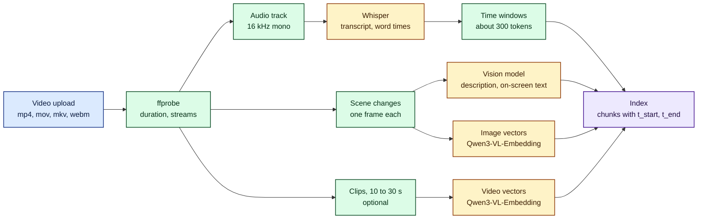

# Plan: video, audio and more file formats

Status: **plan only, not implemented.** This note shows how video and audio files, and a list of other
formats, could be added to ingestion without changing how questions are answered. It names the code that
would change, the settings that would be added, the costs to expect and how to test it. The numbers marked
"estimate" are to be measured before they are relied on.

## 1. Where ingestion stands today

| Piece | Today | File |
|---|---|---|
| Accepted uploads | `.pdf`, `.txt`, `.md`, `.xlsx`, `.csv`, `.png`, `.jpg`, `.jpeg`, `.webp`, checked by extension and magic bytes | `services/ingest/src/ingest/validation.py` (`ALLOWED`, `_MAGIC`) |
| Parsing | `parse_file()` picks one parser per extension and runs it in the isolated child process (timeout, memory limit, crash detection) | `services/ingest/src/ingest/parsers/__init__.py` |
| What a parser returns | `Element`s (text, table, image) with a section and a page, and `Sheet`s for spreadsheets | `services/ingest/src/ingest/elements.py` |
| What is indexed | `ChunkPayload`: text, section, page or sheet rows, an optional image asset, and the run's generation | `libs/common/src/rag_common/index.py` |
| Where a citation points | `location()`: "page 4", "sheet Sales, rows 10-20", "figure" | `services/rag/src/rag/prompts.py` |
| Embeddings | text: Qwen3-Embedding-0.6B; images: Qwen3-VL-Embedding-2B (2,048 numbers) | `services/models` (`/v1/embed/text`, `/v1/embed/image`) |
| Search | four retrievers fused with reciprocal rank fusion, then the reranker: `dense`, `bm25`, `image`, `grep` | `services/rag/src/rag/retrieval.py` |
| Limits | `MAX_UPLOAD_MB` 200, `INGEST_MAX_FIGURES_PER_DOC` 150, `INGEST_PARSE_TIMEOUT_S` 1800 | `.env.example`, `services/ingest/src/ingest/config.py` |

One useful fact: the image embedding model the app already runs, Qwen3-VL-Embedding-2B, lists video as an
input on its model card ("text, images, screenshots, videos") and reports video retrieval scores. The app
sends it images only. Video support needs no new embedding model.

## 2. Video: the idea

A single vector per video, or per clip, can find "the moment where someone draws a chart", but it cannot
answer "what did the speaker say about pricing?" with a citation. So a video is split into timestamped
streams, and each stream goes through the pipeline the app already has:

| Stream | How it is made | What it becomes | Answers questions like |
|---|---|---|---|
| Speech | audio track to a transcript with word timestamps (Whisper) | text chunks of about 300 tokens, each a time window | "What did she say about the budget?" |
| Keyframes | a frame at each scene change (slides, cuts) | image chunks: a description from the vision model and an image vector, like PDF figures | "What was on the slide with the revenue chart?" |
| On-screen text | read from the keyframes by the vision model (or OCR) | part of each keyframe's description | "What URL was shown at the end?" |
| Clips (optional) | short segments of 10 to 30 seconds embedded as video | clip vectors searched like image vectors | "Find the part where the robot picks up the cup" |

Every chunk carries a start and end time, so a citation reads "12:40-13:05" instead of "page 4", and opening
it plays the video from that point.

## 3. Video and audio: the changes, piece by piece

### 3.1 Upload and validation

- Add to `ALLOWED`: `.mp4`, `.mov`, `.mkv`, `.webm` (video) and `.mp3`, `.wav`, `.m4a`, `.ogg`, `.flac`
  (audio), with two new document types in `DocType`: `video` and `audio`.
- Magic bytes in `_MAGIC`: MP4, MOV and M4A have `ftyp` at byte 4; MKV and WebM start with `1A 45 DF A3`;
  WAV is `RIFF....WAVE`; MP3 starts with `ID3` or an MPEG frame sync; Ogg with `OggS`; FLAC with `fLaC`.
- A separate size limit, `INGEST_MAX_MEDIA_MB` (for example 2048), so raising it for video does not raise
  it for every PDF. The gateway's `client_max_body_size` follows the larger of the two.
- A duration limit, `INGEST_MAX_MEDIA_MINUTES` (for example 180), checked with `ffprobe` before anything is
  decoded, so a long file is refused at once with a clear message instead of failing an hour later.

### 3.2 Parsing (in the isolated child, like every other format)

A new parser, `parsers/media.py`, behind `parse_file()`:

1. `ffprobe`: duration, streams, frame rate. No audio stream: skip the transcript. No video stream: an audio
   file, transcript only.
2. Audio: `ffmpeg` extracts 16 kHz mono WAV. **faster-whisper** transcribes it with word timestamps and its
   voice activity filter, so long silences do not produce invented text. Settings: `INGEST_ASR_MODEL`
   (default `small`; `large-v3` for accuracy), `INGEST_ASR_DEVICE` (`cpu` by default, see 3.6),
   `INGEST_ASR_LANGUAGE` (empty: detect).
3. Keyframes: `ffmpeg`'s scene filter (`select='gt(scene,0.3)'`) or PySceneDetect, plus one frame at least
   every `INGEST_KEYFRAME_MAX_GAP_S` (for example 60) so a static talking head still gets a frame. Capped at
   `INGEST_MAX_FRAMES_PER_DOC` (for example 300); past the cap, frames are spread evenly and a warning says
   so, the way the figure cap works today.
4. Clips (optional, phase 4): every `INGEST_CLIP_S` seconds (for example 20), 8 to 16 frames sampled from the
   segment, kept as a small frame list for the video embedding.

The parser returns `Element`s as today, with two new optional fields, `t_start` and `t_end` (seconds), and
`kind` values `transcript`, `frame` and `clip`. Recent Docling versions also include a speech recognition
pipeline for audio; it is worth comparing with calling faster-whisper directly before choosing.

### 3.3 Chunking

- Transcript: windows of about 300 tokens cut at Whisper's segment boundaries (never mid-sentence), with a
  small overlap. The section is the nearest chapter title if the file has chapters, else the time range.
- Keyframes: one image chunk each, exactly like a PDF figure: the vision model's description (including any
  on-screen text) is the searchable text, the frame is the asset, and its image vector goes to the `image`
  retriever. The transcript lines spoken at that moment are added to the chunk's search text, so a slide is
  found by what was said over it too.
- Clips: one chunk each, with a short text (the transcript of the segment) and a video vector.
- A summary chunk per file, as for documents, built from the transcript and the frame descriptions.

### 3.4 Data model

| Change | Where |
|---|---|
| `DocType.VIDEO`, `DocType.AUDIO` | `libs/common/src/rag_common/contracts.py` |
| `ChunkPayload.t_start`, `t_end` (float seconds); chunk kinds `transcript`, `frame`, `clip` | `libs/common/src/rag_common/index.py` |
| `location()` prints "12:40-13:05" (and "frame at 12:40") | `services/rag/src/rag/prompts.py` |
| The original file is kept for playback, in the upload's own folder; frames are assets of the run's generation | `services/ingest/src/ingest/paths.py` (no new layout) |

Existing documents are not affected: the new fields are optional and empty for them, so no reindex is
needed. Deletion, generations and the clean-up of old generations work unchanged, because frames and
transcripts are ordinary assets and chunks of a run.

### 3.5 Models service

- `/v1/embed/video`: a list of frames (one clip) in, one 2,048-number vector out, from the same
  Qwen3-VL-Embedding-2B weights, behind the same GPU gate as images. A new named vector in Qdrant, `video`,
  next to `text` and `image`, and a fifth retriever, `clip`, fused with the others by reciprocal rank fusion
  (weight `RAG_WEIGHT_CLIP`).
- The reranker is text only (Qwen3-Reranker-0.6B). It scores transcript windows and frame descriptions as
  text, which is enough for phases 1 to 3. The model card's companion, Qwen3-VL-Reranker, could rerank
  frames and clips by their pixels later.

### 3.6 Where speech recognition runs

The 27B answer model leaves little GPU memory. Three options, in order of preference:

1. **CPU in the ingest worker** (default): faster-whisper with int8 weights. Slower (estimate: tens of
   minutes for an hour of audio with `small`), but it never competes with answering.
2. **GPU in the models service** when `INGEST_ASR_DEVICE=cuda` and the GPU has room: a few minutes per hour
   of audio (estimate), queued behind the GPU gate like embeddings.
3. **A separate ASR server** on the backend network, for machines with a second GPU.

The weights are downloaded when the image is built and checked offline, like Docling's models, because the
backend has no network at runtime.

### 3.7 Questions and answers

Nothing changes in planning, Deep search, Read all or the answer prompt:

- `dense` and `bm25` search transcript windows and frame descriptions; `image` searches keyframes; `clip`
  searches clips.
- Deep search's `read` tool reads the time windows before and after a hit, the same way it reads
  neighbouring passages today.
- Read all reads the transcript in order, one section per time range.
- Citations carry the time range; the answer prompt needs no change.

### 3.8 Interface

- The upload box and the file picker accept the new extensions; the progress note shows the stages
  ("transcribing 12:00 of 48:00", "reading frame 40 of 120").
- A source card shows the time range and the keyframe thumbnail. Opening it plays the original from
  `t_start` in an HTML5 `<video>` (or `<audio>`) element.
- Playback needs an authenticated route that answers HTTP range requests, so the player can seek without
  downloading the whole file: ingest-api serves the original with a `FileResponse` (recent Starlette
  versions answer `Range`), proxied by the gateway like the figure assets. The page's Content Security
  Policy has no `media-src`, so it falls back to `default-src 'self'` and same-origin media plays without a
  policy change.

### 3.9 Security

- `ffmpeg` and the decoders parse untrusted files, the riskiest code in the pipeline. They run only in the
  isolated child process, with its timeout and memory limit, never in ingest-api.
- `ffprobe` runs first with a short timeout; the duration and stream checks refuse a file before decoding.
- The ingest image gets an LGPL build of `ffmpeg` (no non-free codecs), pinned like the other dependencies.
- No network at runtime, as today. Transcripts and frames belong to the uploader's account and are deleted
  with the document.

### 3.10 Cost of one hour of video (estimates, to be measured)

| Step | Estimate | Note |
|---|---|---|
| Transcript, CPU, `small` | tens of minutes | the slowest step on CPU |
| Transcript, GPU | a few minutes | needs free GPU memory |
| Scene frames | 50 to 300 | a talk with slides is at the low end, a film at the high end |
| Frame descriptions | 10 to 20 s each on the 27B model | the biggest cost; the frame cap bounds it, and the model reply cache makes a reindex cheap |
| Clip vectors | a few minutes | 180 clips of 20 s |
| Index size | about 200 transcript chunks plus the frames | similar to a 100-page PDF |

## 4. Testing

- **Unit tests** with tiny synthetic files made by `ffmpeg` at test time (a test pattern with a tone, two
  scene changes and a burned-in caption), so no media is committed: validation, probing, frame selection,
  window cutting, timestamps on every chunk, the duration and size limits, refusal of a renamed file.
- **A sample set** in `examples/videos/`: openly licensed public videos (public-domain NASA and government
  recordings, CC-BY lectures), with questions whose answers are only in the speech, only on a slide, or only
  visible in the picture, and the expected time range for each.
- **Metrics**: recall at k where a hit is any retrieved chunk overlapping the labelled time range, and
  answer correctness, run by the existing evaluation harness.
- **Live check**: upload, ask one question of each kind, open the citation and confirm the player starts at
  the cited time; delete and confirm the frames, transcript and original are gone.

## 5. Rollout

| Phase | Scope | Size |
|---|---|---|
| 1 | Audio files: transcript only, timestamps in citations | M |
| 2 | Video: transcript and keyframes (descriptions, image vectors) | M |
| 3 | Player in the source panel, range requests, thumbnails | S |
| 4 | Clip vectors and the `clip` retriever | M |
| 5 | Optional: speaker labels (diarization), chapter titles from the file's metadata | M |

Phase 1 alone is useful (meetings, podcasts, voice notes) and exercises most of the new code.

## 6. Other formats worth adding

Ordered by usefulness for a document assistant and by how little new code each needs.

| Format | How | Becomes | Size | Priority |
|---|---|---|---|---|
| Word `.docx` | Docling reads DOCX natively: headings, tables, images | the PDF path: text, tables as SQL tables, figures | S | high |
| PowerPoint `.pptx` | Docling reads PPTX: one slide is one page, speaker notes included | the PDF path; slide images can go through the figure path | S | high |
| Audio `.mp3`, `.wav`, `.m4a` | section 3, phase 1 | transcript windows with timestamps | M | high |
| HTML `.html`, saved web pages | Docling reads HTML; navigation and footers dropped | the PDF path | S | medium |
| Old Excel `.xls`, OpenDocument `.ods` | pandas with `xlrd` / `odfpy`, then the existing sheet layout detection | spreadsheets, SQL tables | S | medium |
| `.tsv`, `.json`, `.jsonl`, `.parquet` | DuckDB reads all of them natively into a table | the SQL path; text fields also chunked for search | S to M | medium |
| Scans `.tiff` (multi-page), phone photos `.heic` | TIFF pages as PDF pages with OCR; HEIC via `pillow-heif` | pages or images | S | medium |
| Email `.eml` (and `.msg`) | the standard library's `email` package (`extract-msg` for Outlook) | sender, date and subject as the section, the body as text; attachments as separate documents | M | medium |
| E-books `.epub` | a ZIP of HTML chapters, through the HTML path | text with chapter sections | S | low |
| Notebooks `.ipynb` | JSON: Markdown cells as text, code cells as code, outputs as text | text | S | low |
| Rich text `.rtf`, `.odt` | Pandoc or LibreOffice headless, both heavy to bake into the image | text | M | low |
| Archives `.zip` | not recommended: ZIP bombs and nested formats; upload the files instead | - | - | no |

Each new format follows the same steps: an entry in `ALLOWED` and `_MAGIC`, a branch in `parse_file()` (in
the isolated child), the upload box's `accept` list, a few small test files, and a line in the user guides.
The Docling formats (DOCX, PPTX, HTML) reuse the PDF parser's element loop almost unchanged and are the
quickest wins.

## 7. Decisions to make before building

- The media size and duration limits, and whether originals are kept for playback (disk) or only the
  transcript and frames.
- Where speech recognition runs on this machine (section 3.6).
- Whether speaker labels are needed (diarization models usually need a separate licence acceptance).
- Which phases to build first, and which of the formats in section 6.
